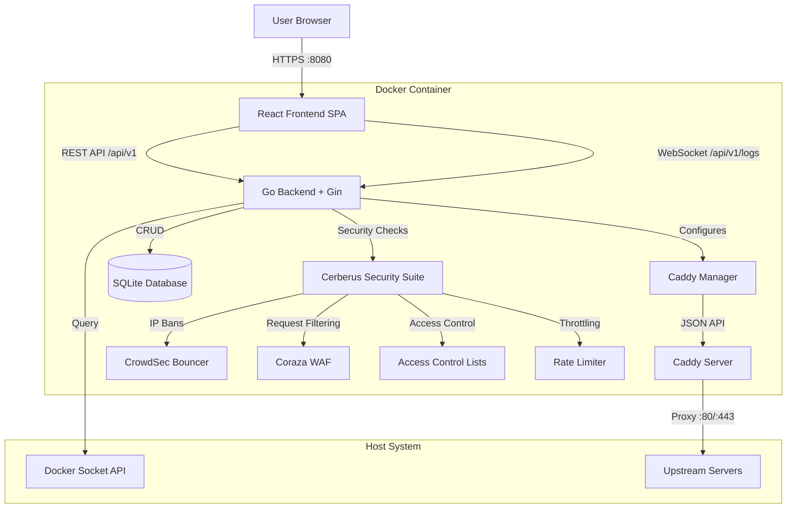
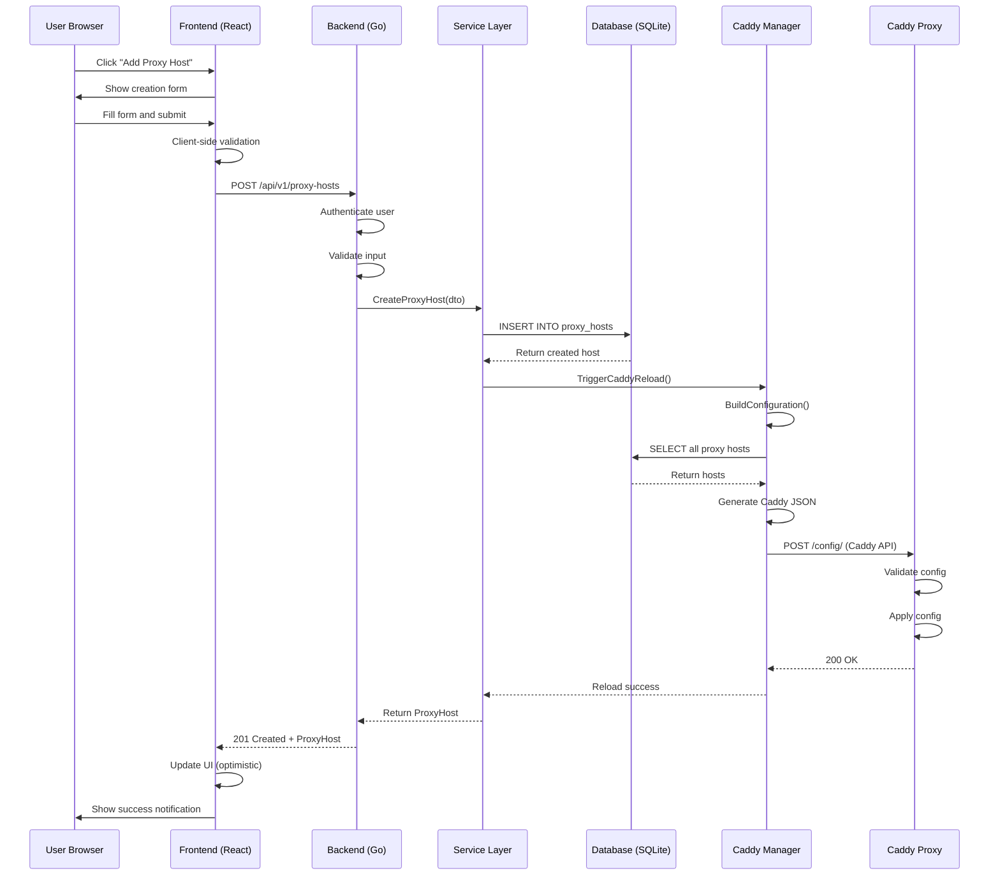
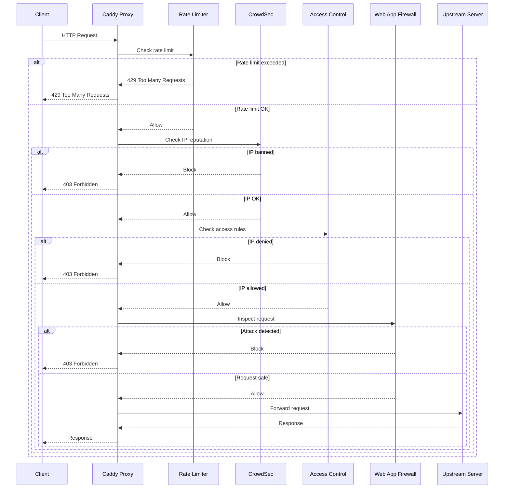
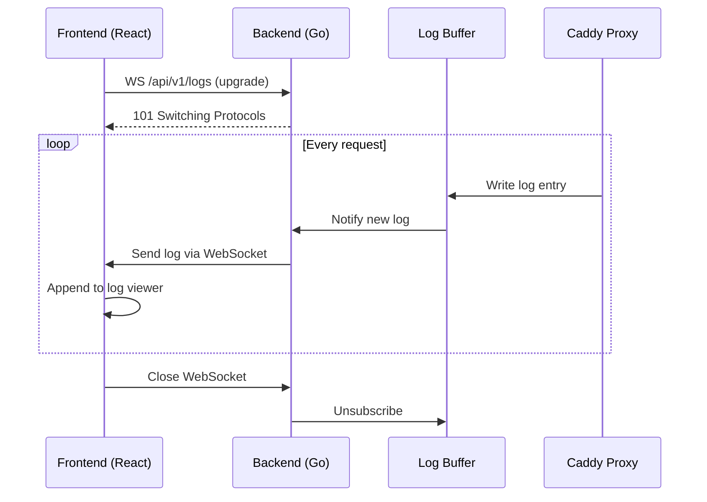
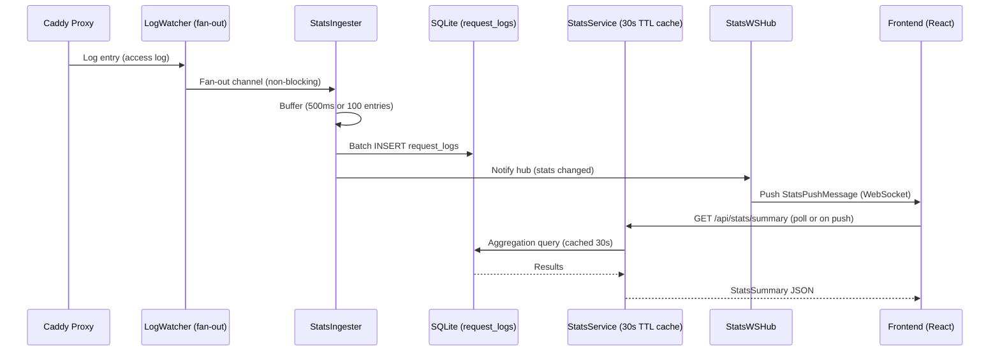
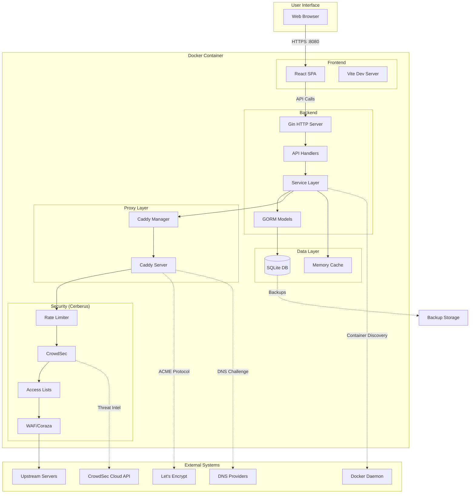

# Charon System Architecture

**Version:** 1.0
**Last Updated:** 2026-01-30
**Status:** Living Document

---

## Table of Contents

- [Overview](#overview)
- [System Architecture](#system-architecture)
- [Technology Stack](#technology-stack)
- [Directory Structure](#directory-structure)
- [Core Components](#core-components)
- [Security Architecture](#security-architecture)
- [Data Flow](#data-flow)
- [Deployment Architecture](#deployment-architecture)
- [Development Workflow](#development-workflow)
- [Testing Strategy](#testing-strategy)
- [Build & Release Process](#build--release-process)
- [Extensibility](#extensibility)
- [Known Limitations](#known-limitations)
- [Maintenance & Updates](#maintenance--updates)

---

## Overview

**Charon** is a self-hosted reverse proxy manager with a web-based user interface designed to simplify website and application hosting for home users and small teams. It eliminates the need for manual configuration file editing by providing an intuitive point-and-click interface for managing multiple domains, SSL certificates, and enterprise-grade security features.

### Core Value Proposition

**"Your server, your rules—without the headaches."**

Charon bridges the gap between simple solutions (like Nginx Proxy Manager) and complex enterprise proxies (like Traefik/HAProxy) by providing a balanced approach that is both user-friendly and feature-rich.

### Key Features

- **Web-Based Proxy Management:** No config file editing required
- **Automatic HTTPS:** Let's Encrypt and ZeroSSL integration with auto-renewal
- **DNS Challenge Support:** 15+ DNS providers for wildcard certificates
- **Docker Auto-Discovery:** One-click proxy setup for Docker containers
- **Cerberus Security Suite:** WAF, ACL, CrowdSec, Rate Limiting
- **Login Protection:** Always-on per-client throttle for sign-in and password-verifying routes
- **Real-Time Monitoring:** Live logs, uptime tracking, and notifications
- **Configuration Import:** Migrate from Caddyfile or Nginx Proxy Manager
- **Supply Chain Security:** Cryptographic signatures, SLSA provenance, SBOM

---

## System Architecture

### Architectural Pattern

Charon follows a **monolithic architecture** with an embedded reverse proxy, packaged as a single Docker container. This design prioritizes simplicity, ease of deployment, and minimal operational overhead.



### Component Communication

| Source | Target | Protocol | Purpose |
| -------- | -------- | ---------- | --------- |
| Frontend | Backend | HTTP/1.1 | REST API calls for CRUD operations |
| Frontend | Backend | WebSocket | Real-time log streaming |
| Backend | Caddy | HTTP/JSON | Dynamic configuration updates |
| Backend | SQLite | SQL | Data persistence |
| Backend | Docker Socket | Unix Socket/HTTP | Container discovery |
| Caddy | Upstream Servers | HTTP/HTTPS | Reverse proxy traffic |
| Cerberus | CrowdSec | HTTP | Threat intelligence sync |
| Cerberus | WAF | In-process | Request inspection |

### Design Principles

1. **Simplicity First:** Single container, minimal external dependencies
2. **Security by Default:** All security features enabled out-of-the-box
3. **User Experience:** Web UI over configuration files
4. **Modularity:** Pluggable DNS providers, notification channels
5. **Observability:** Comprehensive logging and metrics
6. **Reliability:** Graceful degradation, atomic config updates

---

## Technology Stack

### Backend

| Component | Technology | Version | Purpose |
| ----------- | ----------- | --------- | --------- |
| **Language** | Go | 1.26.0 | Primary backend language |
| **HTTP Framework** | Gin | Latest | Routing, middleware, HTTP handling |
| **Database** | SQLite | 3.x | Embedded database |
| **ORM** | GORM | Latest | Database abstraction layer |
| **Reverse Proxy** | Caddy Server | 2.11.2 | Embedded HTTP/HTTPS proxy |
| **WebSocket** | coder/websocket | Latest | Real-time log streaming |
| **Crypto** | golang.org/x/crypto | Latest | Password hashing, encryption |
| **Metrics** | Prometheus Client | Latest | Application metrics |
| **Notifications** | github.com/Wikid82/Hermes | Current | External delivery-engine module (Discord, Slack, Gotify, Pushover, Ntfy, Telegram, generic webhook, Web Push, and email) consumed via Charon-supplied SSRF/SMTP/template adapters — see Service Layer below |
| **Docker Client** | Docker SDK | Latest | Container discovery |
| **Logging** | Logrus + Lumberjack | Latest | Structured logging with rotation |
| **Backup Archive Encryption** | filippo.io/age | Latest | Passphrase (scrypt) encryption of backup archives; audited, pure Go, streaming AEAD — avoids buffering whole archives in RAM or hand-rolling chunked AES-GCM |
| **Remote Backup Storage (S3)** | github.com/minio/minio-go/v7 | v7 | S3-compatible client (AWS S3, MinIO, Backblaze B2, Cloudflare R2); single-module dependency, path-style addressing support |
| **Remote Backup Storage (SFTP)** | github.com/pkg/sftp | Latest | SFTP client over `golang.org/x/crypto/ssh`; de-facto standard, pairs with the existing `x/crypto` dependency |
| **Remote Backup Storage (WebDAV)** | github.com/studio-b12/gowebdav | v0.13.0 | WebDAV client (Nextcloud, ownCloud, generic Apache/nginx `mod_dav`); minimal transitive deps, imperative API maps directly onto the `Uploader` interface |
| **Remote Backup Storage (OAuth)** | golang.org/x/oauth2 | v0.36.0 | Shared authorization-code flow + transparent token refresh for the Dropbox and Google Drive uploaders; Dropbox/Drive's own upload/list/delete REST calls are hand-rolled `net/http` (no vendor SDK), see `internal/services/remotestorage/` |

### Frontend

| Component | Technology | Version | Purpose |
| ----------- | ----------- | --------- | --------- |
| **Framework** | React | 19.2.3 | UI framework |
| **Language** | TypeScript | 6.x | Type-safe JavaScript |
| **Build Tool** | Vite | 8.0.0-beta.18 | Fast bundler and dev server |
| **CSS Framework** | Tailwind CSS | 4.2.1 | Utility-first CSS |
| **Routing** | React Router | 7.x | Client-side routing |
| **HTTP Client** | Fetch API | Native | API communication |
| **State Management** | React Hooks + Context | Native | Global state |
| **Internationalization** | i18next | Latest | 5 language support |
| **Unit Testing** | Vitest | 4.1.0-beta.6 | Fast unit test runner |
| **E2E Testing** | Playwright | 1.64.1 | Browser automation |
| **Theme System** | CSS Custom Properties + data-theme | N/A | `data-theme` attribute on `<html>` drives 5 built-in themes, custom colors, system mode, and logo customization |

### Infrastructure

| Component | Technology | Version | Purpose |
| ----------- | ----------- | --------- | --------- |
| **Containerization** | Docker | 24+ | Application packaging |
| **Base Image** | Debian Trixie Slim | Latest | Security-hardened base |
| **CI/CD** | GitHub Actions | N/A | Automated testing and deployment |
| **Registry** | Docker Hub + GHCR | N/A | Image distribution |
| **Bundled proxy toolchain** | `ghcr.io/wikid82/charon-toolchain` | digest-pinned | Multi-arch prebuilt custom Caddy + CrowdSec binaries; deterministic daily `--no-cache --pull` rebuild + blocking Trivy gate; digest pinned in `Dockerfile` and freshness-guarded per-PR |
| **Security Scanning** | Trivy + Grype + Semgrep | Latest | Vulnerability detection |
| **SBOM Generation** | Syft | Latest | Software Bill of Materials |
| **Signature Verification** | Cosign | Latest | Supply chain integrity |

---

## Directory Structure

```text
/projects/Charon/
├── backend/                    # Go backend source code
│   ├── cmd/                    # Application entrypoints
│   │   ├── api/                # Main API server
│   │   ├── migrate/            # Database migration tool
│   │   └── seed/               # Database seeding tool
│   ├── internal/               # Private application code
│   │   ├── api/                # HTTP handlers and routes
│   │   │   ├── handlers/       # Request handlers
│   │   │   ├── middleware/     # HTTP middleware
│   │   │   └── routes/         # Route definitions
│   │   ├── services/           # Business logic layer
│   │   │   ├── proxy_service.go
│   │   │   ├── certificate_service.go
│   │   │   ├── docker_service.go
│   │   │   ├── mail_service.go
│   │   │   ├── backup_service.go       # Backup creation, safe-restore pipeline, scheduling
│   │   │   ├── backup_remote_service.go
│   │   │   └── remotestorage/          # S3 / SFTP / WebDAV / Dropbox / Google Drive uploader implementations (Uploader interface)
│   │   ├── caddy/              # Caddy manager and config generation
│   │   │   ├── manager.go      # Dynamic config orchestration
│   │   │   └── templates.go    # Caddy JSON templates
│   │   ├── cerberus/           # Security suite
│   │   │   ├── acl.go          # Access Control Lists
│   │   │   ├── waf.go          # Web Application Firewall
│   │   │   ├── crowdsec.go     # CrowdSec integration
│   │   │   └── rate_limit.go   # Opt-in per-client API rate limiting
│   │   ├── ratelimit/          # Shared keyed token-bucket limiter (client keying, 429 responses, capped WARN budgets)
│   │   ├── models/             # GORM database models
│   │   ├── database/           # DB initialization and migrations
│   │   │   └── pending_restore.go      # Boot-time pending-restore swap consumer
│   │   ├── changelog/          # "What's New" changelog service (embedded JSON, no runtime network calls)
│   │   │   └── data/changelog.json     # Build-time generated changelog data (see "Release Workflow")
│   │   └── utils/              # Helper functions
│   ├── pkg/                    # Public reusable packages
│   │   └── safehttp/           # Validated outbound HTTP helpers for in-tree and community DNS provider plugins
│   ├── integration/            # Integration tests
│   ├── go.mod                  # Go module definition
│   └── go.sum                  # Go dependency checksums
│
├── frontend/                   # React frontend source code
│   ├── src/
│   │   ├── pages/              # Top-level page components
│   │   │   ├── Dashboard.tsx
│   │   │   ├── ProxyHosts.tsx
│   │   │   ├── Certificates.tsx
│   │   │   └── Settings.tsx
│   │   ├── components/         # Reusable UI components
│   │   │   ├── forms/          # Form inputs and validation
│   │   │   ├── modals/         # Dialog components
│   │   │   ├── tables/         # Data tables
│   │   │   └── layout/         # Layout components
│   │   ├── api/                # API client functions
│   │   ├── hooks/              # Custom React hooks
│   │   ├── context/            # React context providers (ThemeContext, AuthContext)
│   │   ├── locales/            # i18n translation files
│   │   ├── App.tsx             # Root component
│   │   └── main.tsx            # Application entry point
│   ├── public/                 # Static assets
│   ├── package.json            # NPM dependencies
│   └── vite.config.ts          # Vite configuration
│
├── .docker/                    # Docker configuration
│   ├── compose/                # Docker Compose files
│   │   ├── docker-compose.yml  # Production setup
│   │   ├── docker-compose.dev.yml
│   │   └── docker-compose.test.yml
│   ├── docker-entrypoint.sh    # Container startup script
│   └── README.md               # Docker documentation
│
├── .github/                    # GitHub configuration
│   ├── workflows/              # CI/CD pipelines
│   │   ├── *.yml               # GitHub Actions workflows
│   ├── agents/                 # GitHub Copilot agent definitions
│   │   ├── Management.agent.md
│   │   ├── Planning.agent.md
│   │   ├── Backend_Dev.agent.md
│   │   ├── Frontend_Dev.agent.md
│   │   ├── QA_Security.agent.md
│   │   ├── Doc_Writer.agent.md
│   │   ├── DevOps.agent.md
│   │   └── Supervisor.agent.md
│   ├── instructions/           # Code generation instructions
│   │   ├── *.instructions.md   # Domain-specific guidelines
│   └── skills/                 # Automation scripts
│       └── scripts/            # Task automation
│
├── scripts/                    # Build and utility scripts
│   ├── go-test-coverage.sh     # Backend coverage testing
│   ├── frontend-test-coverage.sh
│   └── docker-*.sh             # Docker convenience scripts
│
├── tests/                      # End-to-end tests
│   ├── *.spec.ts               # Playwright test files
│   └── fixtures/               # Test data and helpers
│
├── docs/                       # Documentation (single source of truth)
│   ├── features/               # Feature documentation
│   ├── guides/                 # User guides
│   ├── api/                    # API documentation
│   ├── development/            # Developer guides
│   ├── plans/                  # Implementation plans
│   └── reports/                # QA and audit reports
│
├── docs-site/                  # Zensical (Python, docs tooling only) docs website — separate from frontend/
│   ├── zensical.toml           # Site config: theme, explicit nav (every synced page must appear in it)
│   ├── requirements.txt        # Pinned zensical version (Renovate tracks it)
│   ├── index.md                # Landing page (copied into docs/ by the sync)
│   ├── assets/                 # Logo, favicon, banner (copied into docs/ by the sync)
│   ├── scripts/sync-docs.sh    # Copies the docs-manifest.json allowlist from docs/ into docs-site/docs/
│   ├── scripts/docs-manifest.json  # Explicit list of docs/ files+dirs to publish
│   └── docs/                   # GENERATED, gitignored — synced from docs/ on every build
│
├── configs/                    # Runtime configuration
│   └── crowdsec/               # CrowdSec configurations
│
├── data/                       # Persistent data (gitignored)
│   ├── charon.db               # SQLite database
│   ├── backups/                # Database backups
│   ├── caddy/                  # Caddy certificates
│   └── crowdsec/               # CrowdSec local database
│       └── data/               # CrowdSec `data_dir`: LAPI db + hub data files (persistent)
│
├── Dockerfile                  # Multi-stage Docker build
├── Makefile                    # Build automation
├── go.work                     # Go workspace definition
├── package.json                # Frontend dependencies
├── playwright.config.js        # E2E test configuration
├── codecov.yml                 # Code coverage settings
├── README.md                   # Project overview
├── CONTRIBUTING.md             # Contribution guidelines
├── CHANGELOG.md                # Version history
├── LICENSE                     # MIT License
├── SECURITY.md                 # Security policy
└── ARCHITECTURE.md             # This file
```

### Key Directory Conventions

- **`internal/`**: Private code that should not be imported by external projects
- **`pkg/`**: Public libraries that can be reused
- **`cmd/`**: Application entrypoints (each subdirectory is a separate binary)
- **`.docker/`**: All Docker-related files (prevents root clutter)
- **`docs/implementation/`**: Archived implementation documentation
- **`docs/plans/`**: Active planning documents (`current_spec.md`)
- **`docs/ci/`**: CI/build operator runbooks (`toolchain-image.md`)
- **`test-results/`**: Test artifacts (gitignored)
- **`docs-site/`**: A standalone [Zensical](https://zensical.org/) static site that publishes `docs/`
  as a browsable website at <https://wikid82.github.io/Charon/>, deployed by
  `.github/workflows/docs-deploy.yml` on push to `main` (or manual dispatch).
  It is entirely separate from `frontend/` (the app's React SPA) — never
  bundled into the Docker image and never served by `backend/internal/server`.
  `docs-site/docs/` is not committed; `docs-site/scripts/sync-docs.sh`
  regenerates it on every build by copying the allowlist in
  `docs-site/scripts/docs-manifest.json` from the repo-root `docs/`, which
  remains the single, untouched source of truth for all documentation. The
  build runs `zensical build --strict`, which fails on broken internal links
  and anchors. Python here is the documented docs-tooling exception to the
  "No Python" rule: `docs-site/requirements.txt` pins `zensical`, and Renovate
  bumps it as `chore:`. The site has no npm dependencies.

**Bundled-toolchain tooling** (see Deployment Architecture → Prebuilt toolchain image):
`.github/workflows/toolchain-image.yml`, `scripts/toolchain-key.sh`,
`scripts/verify-toolchain-pin.sh`, `scripts/lib/dockerfile-stage.sh`. The
`Dockerfile` `crowdsec-fallback` stage was removed (dead code); the
`caddy-builder` / `crowdsec-builder` stages were renamed `caddy-inline` /
`crowdsec-inline` and are now compiled only by the toolchain workflow and the
fork/offline fallback.

---

## Core Components

### 1. Backend (Go + Gin)

**Purpose:** RESTful API server, business logic orchestration, Caddy management

**Key Modules:**

#### API Layer (`internal/api/`)

- **Handlers:** Process HTTP requests, validate input, return responses
- **Middleware:** CORS, GZIP, authentication, logging, metrics, panic recovery
- **Request origin:** The `SelfHop` middleware is first in the engine's chain. For proxy hosts whose upstream is Charon itself, Caddy attaches an authenticated per-boot header (`internal/caddy/self_upstream.go`); the middleware verifies it and records the client address, scheme and host (`RequestOrigin`) for later handlers. Shared helpers live in `internal/security/selfhop`.
- **Caddy admin API:** Caddy serves its admin API on a unix socket (`CHARON_CADDY_ADMIN_API`, default `data/run/caddy-admin.sock`; `/app/data/run/caddy-admin.sock` in the container), created with mode 0600 inside a 0700 directory. No TCP admin listener exists by default, so traffic proxied through a host cannot reach it. The Go client dials the socket (`internal/caddy/client.go`); `charon caddy-admin listen|prepare|get <path>` is the in-container diagnostic. Loopback TCP URLs from older configs are ignored with a startup warning.
- **Caller identity:** Handlers read the signed-in caller through shared accessors in `backend/internal/api/middleware/ctxkeys.go`, enforced by a guard test
- **Routes:** Route registration and grouping (public, authenticated, and admin-only — see [Management API Authentication & Authorization](#management-api-authentication--authorization))

**Example Endpoints:**

- `GET /api/v1/proxy-hosts` - List all proxy hosts
- `POST /api/v1/proxy-hosts` - Create new proxy host
- `PUT /api/v1/proxy-hosts/:id` - Update proxy host
- `DELETE /api/v1/proxy-hosts/:id` - Delete proxy host
- `WS /api/v1/logs` - WebSocket for real-time logs. Live log sockets cap each client message at 4 KB, send pings every 30 s, and close a connection that stays silent for 60 s. Every write has a 10 s deadline. Access-log entries are filtered by `services.LogWatcher` before broadcast: any `token` query parameter is removed from the logged address (`stripQueryToken`), and a query string that cannot be parsed is dropped entirely, so tokens passed in the address never reach log viewers.

#### Service Layer (`internal/services/`)

- **ProxyService:** CRUD operations for proxy hosts, validation logic
- **CertificateService:** ACME certificate provisioning and renewal
- **DockerService:** Container discovery and monitoring; also exposes a lightweight local-socket availability probe (`GET /docker/status`) that the Proxy Host form uses to grey out the "Local (Docker Socket)" source when no usable socket is mounted
- **MailService:** SMTP transport and branded HTML templates for certificate-expiry and other system emails
- **NotificationService:** GORM CRUD for providers/templates, event-type-to-provider routing, and feature-flag gating (`internal/services/notification_service.go`); outbound dispatch for all eight provider types (Discord, Slack, Gotify, Pushover, Ntfy, Telegram, generic webhook, Web Push) plus email is delegated to the external `github.com/Wikid82/Hermes` module (`v0.3.0+`) through three Charon-supplied adapters — `notify_client_adapter.go` (SSRF-safe HTTP client/URL validation, wired to `internal/network`/`internal/security`), `notify_provider_adapter.go`, and `notify_email_adapter.go` (wraps `MailService` behind the module's `Mailer`/`TemplateRenderer` interfaces). `notify_provider_adapter.go`'s `buildNotifySender` maps a `NotificationProvider` row into a `map[string]any` config (`providerConfigMap`) and constructs the `Sender` by calling the module's self-registering provider factory registry (`notify.New(provider.Type, config)`) rather than a hardcoded per-provider switch/constructor call — `notify_providers_import.go` hand-picks the blank imports (`providers/discord`, `providers/slack`, `providers/gotify`, `providers/pushover`, `providers/ntfy`, `providers/telegram`, `providers/webhook`, `providers/webpush`, `providers/email`) that register those factories at `init()` time, deliberately not importing `providers/all`. Charon's own supported-provider allowlist (`isSupportedNotificationProviderType`, `notification_service.go`) remains independently hardcoded and is not derived from the registry; a unit test asserts it stays a subset of `notify.RegisteredTypes()`. The formerly in-repo delivery engine (`internal/notifications/`) has been removed.
  - **Web Push** is the one provider type that isn't a single destination: one `NotificationProvider` row (`Type = "webpush"`, a DB-enforced singleton) holds the shared VAPID application identity, while each subscribed browser/device is a row in a separate `WebPushSubscription` model (`internal/models/webpush_subscription.go`) — FK'd to that provider row, with its own `notify_webpush_adapter.go` fan-out path that sends to every subscription individually and auto-prunes rows the push service reports as gone.
- **SettingsService:** Application settings management
- **BackupService:** Format-v2 archive creation (manifest + SHA-256 checksums), configurable cron scheduling, the safe-restore pipeline (validate → pre-restore safety backup → apply → reconcile), and optional age/scrypt archive encryption — see "Backup & Restore Subsystem" below

**Design Pattern:** Services contain business logic and call multiple repositories/managers

#### Changelog Subsystem (`internal/changelog/`)

Powers the post-login "What's New" modal. `internal/changelog.Service` reads a `//go:embed`-ed `data/changelog.json` (generated at release build time from conventional-commit history — see "Release Workflow" below) and answers "what's new since version X" against the `User.last_seen_version` / `User.changelog_opt_out` columns, via four authenticated routes under `/api/v1/changelog`. No runtime network calls or external dependencies.

- **Version ceiling:** a versioned build never shows entries newer than its own `X.Y.Z`. An unversioned `dev` build has no ceiling, so local UI work sees all entries.
- **Cap:** every status response returns at most the newest 3 entries, whatever the user's stored version is. The full history is available only through the browse route, which the UI pages 10 at a time.
- **Anchor:** "dismiss permanently" stores only the bare `X.Y.Z` of the running build (build labels removed). The stored version never moves backwards, so a downgrade cannot re-show old notes.
- **Validation:** a Security entry whose commit ID is not 7 to 40 hexadecimal characters is dropped before it reaches the browser.

#### Stats Subsystem (`internal/services/stats_*`, `internal/api/handlers/stats_*`)

The stats subsystem collects, aggregates, and broadcasts request metrics for the Dashboard Statistics feature.

**Components:**

- **`RequestLog` model** (`internal/models/request_log.go`): GORM model persisted to the `request_logs` SQLite table. Fields: `HostID`, `Timestamp`, `Method`, `StatusCode`, `BytesSent`, `DurationMs`, `ClientIPHash`. Client IPs are stored as the first 16 bytes of a SHA-256 hash (GDPR-compliant; not reversible).

- **`StatsIngester`** (`internal/services/stats_ingester.go`): Taps the existing `LogWatcher` fan-out channel. Buffers incoming entries and flushes to SQLite in batches (every 500 ms or when 100 entries accumulate). The ingester channel is non-blocking; if the buffer is full, entries are dropped and tracked via `dropped_count` (visible at `GET /api/stats/health`).

- **`StatsService`** (`internal/services/stats_service.go`): Runs aggregation queries against `request_logs` for summary counts, top hosts, status distribution, traffic volume, and request volume. All query results are cached with a 30-second TTL to limit read pressure on SQLite.

- **`StatsWSHub`** (`internal/api/handlers/stats_ws_hub.go`): Implements the `BroadcastHub` interface. Maintains a registry of active WebSocket connections and broadcasts a `StatsPushMessage` to all subscribers whenever the ingester commits a new batch. Clients receive a push signal and re-fetch aggregated data via REST.

**API Endpoints** (all require JWT authentication, mounted under `/api/stats/`):

| Method | Path | Description |
| -------- | ------ | ------------- |
| `GET` | `/summary` | 24 h / 7 d / 30 d request counts |
| `GET` | `/top-hosts` | Top hosts by request count (`period`, `limit`) |
| `GET` | `/status-distribution` | HTTP status code breakdown (`period`) |
| `GET` | `/traffic-volume` | Bytes sent over time (`bucket`) |
| `GET` | `/cert-expiry` | Upcoming SSL cert expirations (`within_days`) |
| `GET` | `/requests` | Request volume over time (`bucket`) |
| `GET` | `/health` | Ingester health including `dropped_count` |
| `WS` | `/ws` | Real-time stats push (upgrade) |

**Frontend:**

- `frontend/src/api/stats.ts` — typed API client and WebSocket helper
- `frontend/src/hooks/useStats.ts` — 6 TanStack Query hooks (one per REST endpoint)
- `frontend/src/hooks/useStatsWebSocket.ts` — WebSocket hook that triggers query invalidation on push
- `frontend/src/components/stats/` — 8 components: `RequestCountWidget`, `TopHostsChart`, `StatusDistributionChart`, `TrafficVolumeChart`, `CertExpiryList`, `ServiceHealthWidget`, `PeriodSelector`, `BucketSelector`

#### Uptime Subsystem (`internal/services/uptime_*`, `internal/api/handlers/uptime_*`)

Monitors the availability of proxy hosts and Sources (remote servers) at per-monitor
intervals and serves the Uptime page. Rebuilt for scale (target ~500 monitors on
one instance) by mirroring the Stats subsystem's buffered-write / cached-read
split. Replaces the former global 1-minute `CheckAll()` + `checkAllHosts()`
ticker.

**Components:**

- **`UptimeScheduler`** (`internal/services/uptime_scheduler.go`): single
  goroutine, ~5 s tick. Maintains two in-memory schedule maps — monitors (keyed
  on the persisted `uptime_monitors.next_check_at`, written back in batches) and
  hosts (due-time = min child-monitor interval, in-memory only). Each tick runs a
  host-connectivity pass then a monitor pass; the monitor pass consults the
  worker pool's `hostState` map and skips TCP monitors of a known-down host.
  Due-times advance by the per-monitor `Interval` (30 s floor;
  `uptime.default_interval_seconds` substituted for zero / legacy / auto-created
  rows). A jittered 60 s cold-start backfill spreads past-due monitors so a
  restart does not stampede. `Rehydrate()` re-syncs the maps after a live DB
  restore.

- **`UptimeWorkerPool`** (`internal/services/uptime_worker_pool.go`): fixed-size
  pool (`uptime.worker_pool_size`, default 30) over a bounded (512) job channel
  carrying `Kind`-discriminated monitor-check and host-check jobs; drop-on-full
  increments `checks_enqueue_dropped`. Owns the **authoritative in-memory
  debounce state** — `monState` per monitor (`{status, failureCount,
  lastStatusChange, lastNotifiedDown}`) and `hostState` per host — both seeded
  from the DB at startup. The worker (not the ingester) read-modify-writes this
  state synchronously, computes status transitions, dispatches notifications, and
  on a host→down transition synthesizes `down` heartbeats for that host's TCP
  monitors. All HTTP checks share one keep-alive SSRF-safe `*http.Client`
  (`network.NewSafeHTTPClient(..., network.WithKeepAlive(100, 4, 30s))`) with the
  same `safeDialer` / no-redirect / localhost + RFC1918 policy as the retired
  per-check client. The host TCP pre-check is now a single non-blocking dial (was
  a `2s × MaxRetries` sleep-retry loop). Shutdown waits on in-flight checks
  (`workerWG`), then closes the results channel.

- **`UptimeIngester`** (`internal/services/uptime_ingester.go`): mirrors
  `StatsIngester`'s batching but is a **pure persistence mirror** — no transition
  detection, no fan-out. Receives `CheckResult` / `HostCheckResult` values on a
  channel the pool owns and closes; `Run` exits only when that channel closes (so
  no in-flight result is lost at shutdown), then does a final flush.
  Batch-inserts `uptime_heartbeats` and coalesces `uptime_monitors` /
  `uptime_hosts` column updates every 500 ms or 100 results in one transaction.
  Drop-on-full increments `heartbeats_dropped`; a dropped write can never
  suppress an alert because runtime detection never reads these columns.

- **`UptimePruner`** (`internal/services/uptime_pruner.go`): hourly, chunked
  `DELETE` (5 000 rows per chunk via `WHERE id IN (SELECT ... LIMIT n)`; 50 ms
  inter-chunk pause steady-state, 250 ms on the first cold pass) of
  `uptime_heartbeats` older than `uptime.heartbeat_retention_days` (default 30).
  `PRAGMA wal_checkpoint(TRUNCATE)` after a large prune; `PRAGMA optimize` daily;
  no downsampling and no `VACUUM`. On a database in incremental auto-vacuum mode,
  each clean pass also returns free pages to the OS in small bounded steps
  (`dbmaint.Drain`). Also owns lazy creation of
  `idx_heartbeat_monitor_created (monitor_id, created_at)` — issued as
  `CREATE INDEX IF NOT EXISTS` at the end of every clean, caught-up pass and
  retried until it lands, so a huge existing table is trimmed before the build.
  `charon migrate` builds the index eagerly, with a warning log.

- **`uptimeConfig`** (`internal/services/uptime_config.go`): a hot-reloading
  (60 s TTL) snapshot of the three `uptime.*` settings, shared by the scheduler,
  pruner, and `UptimeService`. Read-only; writes go through `POST /api/v1/settings`.

- **`UptimeSummaryService`** (`internal/services/uptime_summary_service.go`):
  serves `GET /api/v1/uptime/monitors/summary` from three windowed queries
  (monitor metadata; a `ROW_NUMBER()` recent-beats query bounded to 24 h, default
  30 beats / cap 60; a grouped 24 h-uptime query) behind a 30 s TTL cache — the
  `StatsService` pattern. Correct (just slower) before
  `idx_heartbeat_monitor_created` exists; never 503-gated. Replaces the per-card
  N+1 history fetch on the Uptime page.

- **Targeted monitor sync on mutation:** proxy-host create/update/delete already
  drive `UptimeService.SyncAndCheckForHost` / `SyncMonitorForHost` / inline
  cleanup; remote-server create/update/delete now do the same via
  `SyncAndCheckForRemoteServer` / `SyncMonitorForRemoteServer` / inline cleanup
  (`RemoteServerHandler` gains a nil-guarded `UptimeService`). The 5-minute
  `UptimeSyncLoop` is the backstop. Auto-created monitors inherit
  `uptime.default_interval_seconds` rather than a hardcoded 60.

- **Ordered graceful shutdown:** scheduler stops enqueuing → worker pool drains
  in-flight checks → pool closes the ingester channel → ingester does its final
  flush. `cmd/api/main.go` allows up to 25 s for this chain.

**Settings** (`models.Setting`, `Category = "uptime"`, editable via
`POST /api/v1/settings` and the SystemSettings "Uptime Monitoring" card):

| Key | Default | Bounds | Hot-reload |
| ----- | --------- | -------- | ----------- |
| `uptime.default_interval_seconds` | 60 | 30 – 86400 | Yes (~60 s TTL) |
| `uptime.worker_pool_size` | 30 | 1 – 200 | No — restart to apply |
| `uptime.heartbeat_retention_days` | 30 | 1 – 3650 | Yes (read each pruner pass) |

**API Endpoints** (JWT auth, mounted in the `management` group):

| Method | Path | Description |
| -------- | ------ | ------------- |
| `GET` | `/api/v1/uptime/monitors/summary` | Per-monitor status, latency, last check, 24 h uptime %, and a `recent_beats` sparkline series — one response, 30 s cached |
| `GET` | `/api/v1/uptime/monitors/:id/history` | Detailed heartbeat history for one monitor — `limit` (≤ 500), `before` cursor |
| `GET` | `/api/v1/uptime/health` | `heartbeats_dropped`, `checks_enqueue_dropped`, `queue_depth`, `worker_pool_size` |

#### Backup & Restore Subsystem (`internal/services/backup_service.go`, `internal/services/remotestorage/`, `internal/database/pending_restore.go`)

Format-v2 backup archives, a validated safe-restore pipeline, optional archive encryption, and remote storage to S3, SFTP, WebDAV, Dropbox, or Google Drive. Extends the original v1 backup system (zip + `VACUUM INTO` SQLite snapshot).

**Components:**

- **`BackupService`** (`internal/services/backup_service.go`): Creates format-v2 `.zip` archives containing the SQLite snapshot, `caddy/`, `crowdsec/`, and a `manifest.json` (SHA-256 checksum per entry, written last since checksums accumulate while each preceding entry streams into the archive). Runs the configurable `robfig/cron/v3` schedule, count-based local/remote retention pruning, and the `RestoreBackupSafe` pipeline: **validate** (manifest/checksum verification, `PRAGMA integrity_check` on a temp copy) → **safety backup** (`pre_restore`-type backup of current state, exempt from retention pruning) → **apply** (extract + `RehydrateLiveDatabase` live rehydrate via `ATTACH DATABASE`) → **reconcile** (Caddy `ApplyConfig` reload). v1 archives (no manifest) and v0 raw `.db` files (upload-only, magic-byte detected) remain restorable through the same code path. Backup creation and restore both run this way: as a tracked background goroutine (`BackupJob` model, `jobWG`, mirroring the remote-upload `sync.WaitGroup` pattern above) rather than inline on the request goroutine, with any job left `running`/`pending` at a prior crash reconciled to `failed` by `reconcileStuckBackupJobs` at the next startup. Clients get an immediate `202 Accepted` with a `job_id` and poll `GET /api/v1/backups/jobs/:job_id` for progress and the final result, instead of blocking on the original request for the archive/restore's full duration.

- **Pending-restore boot-swap** (`internal/database/pending_restore.go`, `ApplyPendingRestore`): When live rehydrate can't complete after its retry budget, the already-validated restored database is written to a durable `<DatabaseName>.pending-restore` file (fsync'd, survives a container restart — unlike the OS temp dir the old code relied on). `ApplyPendingRestore` is wired into `cmd/api/main.go` immediately **before** `database.Connect`, so it runs before GORM opens any WAL pool: it re-verifies integrity, then swaps the pending file over the live database file, or renames it to `.pending-restore.failed` and leaves the old database untouched if the second integrity check fails. **Not** wired into the `migrate`/`reset-password` CLI subcommand paths — only the running-server boot path. Because Caddy/CrowdSec files are written to disk during the "apply" step regardless of whether the database rehydrate succeeded, there is a bounded window after a fallback restore where Caddy/CrowdSec already reflect the restored state while the database itself is still pre-restore, until the next process start completes the swap — see `docs/features/disaster-recovery.md`.

- **`remotestorage` package** (`internal/services/remotestorage/`): `Uploader` interface (`Upload`, `Delete`, `List`, `Test`) implemented by `s3.go` (minio-go/v7, S3-compatible endpoints), `sftp.go` (pkg/sftp over `x/crypto/ssh`), `webdav.go` (gowebdav, SSRF-checked like S3/SFTP), `dropbox.go`, and `googledrive.go` (both hand-rolled `net/http` REST clients, no vendor SDK). SFTP uses a two-phase host-key model — an unauthenticated discovery dial that aborts before any credentials are sent, then a verified dial pinned to the confirmed `ssh.FixedHostKey`. Upload goroutines are tracked via `sync.WaitGroup` and canceled on `BackupService.Stop()` so shutdown doesn't leave an upload half-written; `BackupRemoteCopy` rows stuck in `uploading` from a prior crash are reconciled to `failed` at the next startup. `RemoteObject` carries both `Key` (the provider-native locator passed back into `Delete` — a path for S3/SFTP/WebDAV/Dropbox, an opaque file ID for Google Drive) and `Name` (always the human-readable backup filename), so retention pruning filters candidates by `Name` regardless of how the provider addresses objects.

- **OAuth token subsystem** (`internal/services/remotestorage/oauthtoken.go`, `internal/services/oauth_state_store.go`): Dropbox and Google Drive targets connect via a browser-based OAuth2 authorization flow (`golang.org/x/oauth2`) instead of a static credential, so the admin never pastes a Dropbox/Google password into Charon. `OAuthStateStore` is an in-memory, single-use, 10-minute-TTL CSRF-state store guarding the callback route (which cannot require a Charon session, since the browser arrives there directly from the provider). Access/refresh tokens are encrypted and stored in the target's existing `SecretsEncrypted` blob; a `persistingTokenSource` wraps `oauth2.Config.TokenSource` so a transparent refresh is re-encrypted and saved back automatically. The `redirect_uri` is built from the existing `app.public_url` `Setting` (the same value already used for invite-email links) — no new config surface.

- **Archive encryption:** optional age/scrypt passphrase encryption of the whole finished archive (`backup_<ts>.zip.age`), off by default. Reuses the existing `crypto.EncryptionService` (`CHARON_ENCRYPTION_KEY`) only to store a *scheduled* backup's passphrase at rest — the archive encryption itself is a separate, unrelated layer with no recovery path if the passphrase is lost.

**API Endpoints** (mounted under the existing `management` group in `internal/api/routes/routes.go`; mutating routes additionally require admin):

| Method | Path | Description |
| -------- | ------ | ------------- |
| `GET` | `/api/v1/backups` | List backups (DB-backed, reconciled with filesystem) |
| `POST` | `/api/v1/backups` | Start a backup job — `202 Accepted` + `job_id` (admin) |
| `DELETE` | `/api/v1/backups/:filename` | Delete backup (admin) |
| `GET` | `/api/v1/backups/:filename/download` | Download archive (admin — full DB dump) |
| `POST` | `/api/v1/backups/:filename/restore` | Start the safe-restore pipeline as a job — `202 Accepted` + `job_id` (admin) |
| `GET` | `/api/v1/backups/jobs/:job_id` | Poll a create/restore job's status, progress stage, and result (admin) |
| `POST` | `/api/v1/backups/upload` | Upload a backup for validation + restore (admin) |
| `POST` | `/api/v1/backups/:filename/validate` | Dry-run validation (admin) |
| `GET`/`PUT` | `/api/v1/backups/settings` | Schedule/retention/encryption settings |
| `GET`/`POST`/`PUT`/`DELETE` | `/api/v1/backups/remote-targets[/:uuid]` | Remote storage target CRUD (admin) |
| `POST` | `/api/v1/backups/remote-targets/:uuid/test` | Remote target connectivity test (admin) |
| `POST` | `/api/v1/backups/remote-targets/:uuid/oauth/start` | Begin Dropbox/Google Drive OAuth authorization (admin) |
| `GET` | `/api/v1/backups/remote-targets/oauth/:provider/callback` | OAuth provider callback — no session auth; guarded by a single-use CSRF `state` token instead |
| `POST` | `/api/v1/backups/remote-targets/:uuid/oauth/disconnect` | Clear OAuth tokens for a Dropbox/Google Drive target (admin) |

**Frontend:** `frontend/src/pages/Backups.tsx` plus `frontend/src/components/backups/` (`RestoreDialog`, `UploadBackupButton`, schedule/encryption/remote-target cards), backed by `frontend/src/hooks/useBackups.ts` and `frontend/src/api/backups.ts`.

#### Orthrus Agent (`internal/orthrus/`, `agent/`)

Orthrus is a small agent that runs beside a Docker host and dials out to Charon. Charon then reaches that host's Docker API over the agent's connection, so no inbound port or socket mount is needed in Charon. There are two parts:

- **Charon side** (`backend/internal/orthrus/`): the WebSocket endpoint, the handshake, one yamux-multiplexed session per connected agent, the read-only Docker API allow-list (`muzzle.go`), and the optional external Docker proxy listener.
- **Agent side** (`agent/`, a standalone Go module): reads its key file, drops to the low-privilege PUID/PGID, dials Charon, serves allowed Docker API requests from the local socket, and enforces its own copy of the allow-list.

Key behaviour:

- **Handshake:** the agent names itself by UUID (`X-Orthrus-Name`). Keys are bcrypt-hashed (cost 12) and only the hash is stored. Failures are budgeted per client address and agent (10 per minute), with a global budget for uuid-less scans and at most two concurrent verifications.
- **Key delivery:** `ORTHRUS_AUTH_KEY_FILE` is preferred. The agent reads it before `privdrop` (`agent/keyfile.go`, at most 4 KiB, trimmed). Precedence is file, then `ORTHRUS_AUTH_KEY`, then `--auth-key`; setting both file and env is fatal. `newAuthKey` is shared by provisioning and rotation.
- **Rotation:** `POST /orthrus/agents/:uuid/rotate-key` (admin) replaces the hash, disconnects the live session, returns the new key once with `Cache-Control: no-store`, and writes audit event `orthrus_key_rotated` (the key is never logged). UUID, name, bind settings, write mode and remote-server links are unchanged.
- **External proxy listen address** (`bind.go`): resolved at every agent connect, never cached. Explicit IP or CIDR is used as given (a CIDR with no local match is a status error, with no wildcard fallback). Automatic mode uses the default-route interface, then a single non-loopback interface, then `127.0.0.1` with `bind_fallback` set. Automatic never binds `0.0.0.0`. Each listener caps at 256 connections.
- **Docker API allow-list:** the backend and agent copies of `muzzle.go` must match; `scripts/ci/check_muzzle_allowlist_parity.go` enforces that at commit time. In read-only sessions, `/distribution/<ref>/json` also requires `registryLookupAllowed` (refuses IP-literal, `localhost`, single-label and numeric-looking registry hosts; mirrored table tests). Ordinary DNS names are not resolved, so that residual is documented.
- **Environment redaction** (`redact.go`): `GET /containers/*/json` is rewritten in read-only and write-enabled sessions. `Config.Env` values become `[redacted]`, keys are kept, and `Accept-Encoding` is removed upstream. Bodies over 8 MiB, gzip-encoded bodies and invalid JSON return 502 (fail closed). `/images/*/json` and `/containers/*/top` are not rewritten.
- **Stream bounds:** the agent allows 256 concurrent streams, an accept backlog of 64, and a 10-second deadline for the stream type byte and HTTP request header (cleared before body streaming). Charon's yamux accept backlog is 8, because Charon never accepts agent-opened streams. Unknown stream types, including the removed forwarding type, are closed without dialing.
- **Unencrypted link rule** (`validateServerURL` in `agent/main.go`, mirrored by `isPrivateAgentHost` in `services/orthrus_service.go`): `wss://` is always accepted. `ws://` is accepted only for private hosts, or with `ORTHRUS_ALLOW_INSECURE_WS=true`. Install snippets add a comment when a `ws://` URL would be refused.
- **Install snippets** (`services/orthrus_service.go`): Docker Compose and Kubernetes only. The key is delivered as a file secret. The image tag comes from `agentImageTag(version.Version)`: a release `X.Y.Z` pins `X.Y.Z`, `+dev.` maps to `dev`, `+nightly.` maps to `nightly`, and anything else maps to `latest` with a comment.
- **Release images:** `orthrus-build.yml` is a reusable workflow (`workflow_call`) that `docker-build.yml` calls from its `orthrus-release` job on release commits to `main`, publishing `X.Y.Z` and `X.Y`. The workflow also runs on `agent/**` changes and on manual dispatch, where the `release_version` input backfills tags (main only). The `v*` tag is not a trigger, because release-please creates tags with `GITHUB_TOKEN`, which cannot start workflows.

#### Caddy Manager (`internal/caddy/`)

- **Manager:** Orchestrates Caddy configuration updates
- **Config Builder:** Generates Caddy JSON from database models
- **Reload Logic:** Atomic config application with rollback on failure
- **Security Integration:** Injects Cerberus middleware into Caddy pipelines

**Responsibilities:**

1. Generate Caddy JSON configuration from database state
2. Validate configuration before applying
3. Trigger Caddy reload via JSON API
4. Handle rollback on configuration errors
5. Integrate security layers (WAF, ACL, Rate Limiting)

**RedirectionHost (peer resource to ProxyHost):** `internal/models/redirection_host.go`
is a separate, sibling model (same pattern as `ProxyGroup`) — not a mode flag
on `ProxyHost` — for domains that should receive an HTTP redirect
(301/302/307/308) instead of being reverse-proxied to a backend. It has no
`ForwardHost`/`ForwardPort`/`Locations`/ACL/WAF fields, only a `TargetURL`
and `StatusCode`. Its own `BuildRedirectRoutes` (`internal/caddy/redirect_routes.go`)
emits a `static_response` handler (Caddy's underlying mechanism for the
Caddyfile `redir` directive — there is no dedicated `redir` JSON module) per
enabled host, appending Caddy's `{http.request.uri}` placeholder to the
target when "preserve path" is enabled. `GenerateConfig` (`internal/caddy/config.go`)
takes `[]models.RedirectionHost` via a `GenerateConfigOption` functional
option (`WithRedirectionHosts`, replacing the function's former
`...*crypto.EncryptionService` trailing variadic) so redirect-host domains
are folded into the same `processedDomains` de-dup map and TLS
automation-policy collection used for `ProxyHost`, preventing a domain from
being silently claimed by both resource types. Domain-uniqueness is
enforced cross-table by `internal/services/domain_uniqueness.go`'s
`CheckDomainConflict`, called additively by both `ProxyHostService` and
`RedirectionHostService` alongside each service's own unchanged same-table
check.

#### Security Suite (`internal/cerberus/`)

- **ACL (Access Control Lists):** IP-based allow/deny rules, GeoIP blocking
  - **Country lists (GeoIP):** Enforced in Caddy, not in Charon's API. When at least one enabled country list is in use, the generator adds the `geoip2` app (database directory and edition split from the configured `.mmdb` path, lock file in Charon's Caddy data directory, no account or key) and a `geoip2` handler with `enable: "strict"` immediately before the country subroute. Charon checks database availability at generation time (file exists, name ends in `.mmdb`, `GeoIPService` loaded it). When unavailable, country lists are not enforced: no `geoip2` handler and no country deny route are generated for them (fail-open, so a missing database never locks out visitors), with one Warn per apply and a passive `geoip_unavailable` reason on `/security/status`. The enforcement report of the last successful apply records which lists were left unenforced (`EnforcementReport.CountryListsWithoutDatabase`, read through `Manager.LastAppliedReport`); a failed apply keeps that report, because Caddy keeps running the last applied config. `POST /security/geoip/reload` loads the file and applies the proxy config even when the load fails.
  - **Active alerts:** `internal/alerts` computes alerts at request time from the last applied report, not from stored rows. `GET /notifications/alerts` (management) returns them, and the notification bell shows them in red with a link to the GeoIP troubleshooting page. The current alert is `geoip_unavailable`, which appears while country lists are not enforced and clears by itself once a successful apply enforces them again.
  - **GeoIP database store:** Replace, remove and reload (admin only, same-origin for cookie sessions) write only the data-folder copy `data/geoip/GeoLite2-Country.mmdb` (plus transient `.prev` and upload temp files). The bundled copy in `/app/geoip` is never modified. Backups do not include `data/geoip/`.
  - **Allow lists without rules:** An enabled allow list with no rules, or rules that cannot be read, becomes a 403 deny handler with one Warn per apply. A block list with no rules is left out, since it blocks nobody.
- **WAF (Web Application Firewall):** Coraza engine with user-provided rule sets (CRS-compatible)
- **CrowdSec:** Behavior-based threat detection with global intelligence
- **Rate Limiter:** Opt-in per-client API throttling (shared `internal/ratelimit` component)
- **Login Protection:** Always-on per-client throttle in front of `/api/v1/auth/*` and every password-verifying route, independent of Cerberus settings

**Integration Points:**

- Middleware injection into Caddy request pipeline
- Database-driven rule configuration
- Metrics collection for security events

**Module switch resolution:** Whether the WAF, the rate limit or the ACL is on is resolved in one place (`internal/models`). A settings key set to `true` or `false` wins; otherwise the default security config row is used; otherwise the static configuration. Cerberus off forces every module off. All writers (the toggles, the settings save, the config save and the patch route) update the switch and, for the WAF and rate limit, the row mirror in one write-locked transaction. A proxy apply that fails restores both. `GET /security/status` reports the applied state from the last successful apply.

#### Database Layer (`internal/database/`)

- **Migrations:** Automatic schema versioning with GORM AutoMigrate
- **Seeding:** Default settings and admin user creation
- **Connection Management:** SQLite with WAL mode and connection pooling

**Schema Overview:**

- **ProxyHost:** Domain, upstream target, SSL config
- **RedirectionHost:** Peer resource to ProxyHost — domain(s), target URL, redirect status code (301/302/307/308), no upstream/backend
- **RemoteServer:** Upstream server definitions
- **CaddyConfig:** Generated Caddy configuration (audit trail)
- **SSLCertificate:** Certificate metadata and renewal status
- **AccessList:** IP whitelist/blacklist rules
- **User:** Authentication and authorization
- **Setting:** Key-value configuration storage
- **ImportSession:** Import job tracking
- **RequestLog:** Per-request stats record (HostID, Timestamp, Method, StatusCode, BytesSent, DurationMs, ClientIPHash)

### 2. Frontend (React + TypeScript)

**Purpose:** Web-based user interface for proxy management

**Component Architecture:**

#### Pages (`src/pages/`)

- **Dashboard:** System overview, recent activity, quick actions
- **ProxyHosts:** List, create, edit, delete proxy configurations
- **Certificates:** Manage SSL/TLS certificates, view expiry
- **Settings:** Application settings, security configuration
- **Logs:** Real-time log viewer with filtering
- **Users:** User management (admin only)

#### Components (`src/components/`)

- **Forms:** Reusable form inputs with validation
- **Modals:** Dialog components for CRUD operations
- **Tables:** Data tables with sorting, filtering, pagination
- **Layout:** Header, sidebar, navigation

#### API Client (`src/api/`)

- Centralized API calls with error handling
- Request/response type definitions
- Authentication token management

**Example:**

```typescript
export const getProxyHosts = async (): Promise<ProxyHost[]> => {
  const response = await fetch('/api/v1/proxy-hosts', {
    headers: { Authorization: `Bearer ${getToken()}` }
  });
  if (!response.ok) throw new Error('Failed to fetch proxy hosts');
  return response.json();
};
```

#### State Management

- **React Context:** Global state for auth, theme, language
- **Local State:** Component-specific state with `useState`
- **Custom Hooks:** Encapsulate API calls and side effects

**Example Hook:**

```typescript
export const useProxyHosts = () => {
  const [hosts, setHosts] = useState<ProxyHost[]>([]);
  const [loading, setLoading] = useState(true);

  useEffect(() => {
    getProxyHosts().then(setHosts).finally(() => setLoading(false));
  }, []);

  return { hosts, loading, refresh: () => getProxyHosts().then(setHosts) };
};
```

### 3. Caddy Server

**Purpose:** High-performance reverse proxy with automatic HTTPS

**Integration:**

- Embedded as a library in the Go backend
- Configured via JSON API (not Caddyfile)
- Listens on ports 80 (HTTP) and 443 (HTTPS)

**Features Used:**

- Dynamic configuration updates without restarts
- Automatic HTTPS with Let's Encrypt and ZeroSSL
- DNS challenge support for wildcard certificates
- HTTP/2 and HTTP/3 (QUIC) support
- Request logging and metrics

**Configuration Flow:**

1. User creates proxy host via frontend
2. Backend validates and saves to database
3. Caddy Manager generates JSON configuration
4. JSON sent to Caddy via `/config/` API endpoint
5. Caddy validates and applies new configuration
6. Traffic flows through new proxy route

**Route Pattern: Main Route (plus a recovery route for Charon's own host)**

For each proxy host, Charon generates a **main route** with the domain and no path matchers. Its handlers run in a fixed order before the reverse proxy: security headers first, then the Cerberus security checks, then the proxy. Locations are generated as separate path-matched routes that run the same order.

1. **Main Route** (without path matchers):
   - Matches: All paths for the domain
   - Purpose: Normal application traffic with full security
   - Handlers: Security headers (applied to every response, including refusals), then the Cerberus security checks, then the reverse proxy. Country lists are checked by a `geoip2` handler placed immediately before the country subroute.

2. **Recovery Route** (exact path matchers, only for a host that proxies Charon itself):
   - Matches: exactly `/api/v1/emergency/security-reset` and `/emergency/security-reset`, with no wildcards
   - Purpose: Recovery route for the reset endpoint. The endpoint performs its own token and management-network checks.
   - Handlers: Skips the security pre-handlers; no other path under `/emergency/` takes this route, token endpoints included

A host that proxies Charon gets a recovery route for the reset endpoint. Every other host gets only its main route and its locations.

Caddy processes routes in order, so the recovery route (when present) is evaluated before the main route. Validator allows duplicate hosts when one has paths and one doesn't.

**Example:**

```json
// Recovery Route (only for a host whose upstream is Charon; evaluated first)
{
  "match": [{"host": ["charon.example.com"], "path": ["/api/v1/emergency/security-reset", "/emergency/security-reset"]}],
  "handle": [/* reverse proxy only */],
  "terminal": true
}

// Main Route (evaluated second)
{
  "match": [{"host": ["app.example.com"]}],
  "handle": [/* Security headers, security checks, then proxy */],
  "terminal": true
}
```

### 4. Database (SQLite + GORM)

**Purpose:** Persistent data storage

**Why SQLite:**

- Embedded (no external database server)
- Serverless (perfect for single-user/small team)
- ACID compliant with WAL mode
- Minimal operational overhead
- Backup-friendly (single file)

**Configuration:**

- **WAL Mode:** Allows concurrent reads during writes
- **Foreign Keys:** Enforced referential integrity
- **Pragma Settings:** Performance optimizations
- **Single Writer:** `SetMaxOpenConns(1)` serializes all writes through one
  connection. The high-volume stats and uptime write paths are both funnelled
  through a buffered ingester that batch-inserts every 500 ms instead of writing
  on the request/check goroutine — this is what keeps a single write connection
  viable at ~500 uptime monitors. Authoritative uptime debounce state lives in
  memory (the worker pool's `monState` / `hostState` maps); the DB columns are a
  persistence mirror.

**Backup Strategy:**

- Configurable scheduled backups (daily/weekly presets or custom cron) to `data/backups/`, plus on-demand manual backups
- Count-based retention (default: most recent 7 backups locally, most recent 7 per remote target) — not day-based
- An automatic `pre_restore` safety backup is taken immediately before every restore, exempt from the regular retention count
- See "Backup & Restore Subsystem" above for the full pipeline

**Migrations:**

- GORM AutoMigrate for schema changes
- Manual migrations for complex data transformations
- Rollback support via backup restoration

**Data lifecycle:**

- `uptime_heartbeats` rows are hard-deleted on a rolling window
  (`uptime.heartbeat_retention_days`, default 30) by a background hourly pruner —
  the only automatic data deletion in Charon.
- The `idx_heartbeat_monitor_created` index is created lazily by that pruner
  (`CREATE INDEX IF NOT EXISTS`, retried until it lands), not by AutoMigrate, so
  an upgrade never stalls on a migration-time index build. On a very large
  existing table the first background build is still a bounded multi-minute,
  write-contending operation; `charon migrate` builds it eagerly, with a warning
  log, for an out-of-band maintenance window.
- The former redundant single-column `monitor_id` index on `uptime_heartbeats` was
  dropped (it was a strict prefix of the composite index). The pruner's age query
  is index-bounded, so each hourly pass scans only the rows it deletes.
- Deleted rows free pages inside the SQLite file. New databases are created in
  incremental auto-vacuum mode and the pruner returns free pages to the OS in
  small steps. Existing databases (auto-vacuum off) are converted once at boot by
  the `internal/dbmaint` package when the free space is worth it (>= 20% free
  pages AND >= 100 MB reclaimable, or >= 1 GiB reclaimable; the 100 MB floor
  always applies). `CHARON_DB_COMPACT_ON_START` (`auto` default, `off`) controls
  the boot conversion. The admin UI is the Tasks -> Database page (`/tasks/database`,
  admin only), backed by `GET/POST/DELETE /system/database...`; it is passive
  information plus an optional "reclaim on next restart" request, and nothing
  outside that page signals database state.
- **Maintenance gate and startup ordering.** Caddy starts first with an empty
  config; Charon then pushes the proxy hosts to it. The conversion (a `VACUUM` on
  the pool's single pinned connection) starts only after the initial config has
  been applied AND the HTTP listener is bound, so proxying never depends on the
  SQLite file. While it runs, the gate (installed in `cmd/api/main.go` before the
  routes) answers `/api/v1/maintenance/status` (always) and health (only while it
  runs; otherwise health stays under the normal rate limiting) itself, serves a
  short "Optimizing the database" page and 503s the rest of the management API
  and the emergency server; the uptime pipeline and scheduled backups wait for
  release. A stop mid-run is safe (`VACUUM` is atomic); an unfinished run is
  retried at the next boot, up to 3 failed attempts or 5 orderly stops. Details: `docs/database-maintenance.md`.
- The E2E/CI compose files (`playwright-ci`, `playwright-local`) default
  `CHARON_DB_COMPACT_ON_START=off` so test databases are never converted mid-suite.

---

## Security Architecture

### Defense-in-Depth Strategy

Charon implements multiple security layers (Cerberus Suite) to protect against various attack vectors:

```mermaid
graph LR
    Internet[Internet] -->|HTTP/HTTPS| RateLimit[Rate Limiter]
    RateLimit -->|Throttled| CrowdSec[CrowdSec Bouncer]
    CrowdSec -->|Threat Intel| ACL[Access Control Lists]
    ACL -->|IP Whitelist| WAF[Web Application Firewall]
    WAF -->|User rule sets| Caddy[Caddy Proxy]
    Caddy -->|Proxied| Upstream[Upstream Server]

    style RateLimit fill:#f9f,stroke:#333,stroke-width:2px
    style CrowdSec fill:#bbf,stroke:#333,stroke-width:2px
    style ACL fill:#bfb,stroke:#333,stroke-width:2px
    style WAF fill:#fbb,stroke:#333,stroke-width:2px
```



### Layer 1: Rate Limiting

**Purpose:** Prevent brute-force attacks and API abuse

**Implementation:**

- Opt-in per-client token bucket in the Go layer (`internal/cerberus/rate_limit.go`), built on the shared `internal/ratelimit` component (`golang.org/x/time/rate`)
- Defaults: 100 requests per 60 s, burst 20; overridable through settings or `CHARON_SECURITY_RATELIMIT_{REQUESTS,WINDOW}`
- Bounded memory (default 10,000 tracked clients) and no background goroutines
- HTTP 429 with a `Retry-After` header when the limit is exceeded
- Validated administrator requests to the security, settings and config control-plane paths are exempt (identity established by `OptionalAuth`, never by a raw `Authorization` header)
- Valid emergency bypass requests are never limited

Sign-in protection is a separate, always-on limiter described under "Management API Authentication & Authorization".

### Layer 2: CrowdSec Integration

**Purpose:** Behavior-based threat detection

**Features:**

- Local log analysis (brute-force, port scans, exploits)
- Global threat intelligence (crowd-sourced IP reputation)
- Automatic IP banning with configurable duration
- Decision management API (view, create, delete bans)
- IP whitelist management: operators add/remove IPs and CIDRs via the management UI; entries are persisted in SQLite and regenerated into a `crowdsecurity/whitelists` parser YAML on every mutating operation and at startup
- Engine lifecycle: one CrowdSec lifecycle owner starts and stops the engine for the API, the settings endpoint and both emergency reset paths (the main API and the separate emergency server)

**CrowdSec bouncer key precedence:** the bouncer key is the shared secret the Caddy bouncer uses to talk to the CrowdSec Local API. One rule set, in `backend/internal/crowdsec/bouncerkey`, is used by the proxy config, the handlers and startup:

0. A key held in memory (only after a failed save of a new key) is tested first. It is dropped once the key file holds the same key or the Local API rejects it.
1. A saved key file (`bouncer_key` in the CrowdSec data folder, `/app/data/crowdsec/bouncer_key` by default; one function, `bouncerkey.PathFor`, derives the path for the handlers, startup and the proxy config, and `CHARON_CROWDSEC_BOUNCER_KEY_PATH` overrides it everywhere) that the Local API accepts wins. Environment values are not tested in this case.
2. Otherwise the first non-empty environment variable is tested and, if accepted, saved to the key file. Lookup order: `CHARON_SECURITY_CROWDSEC_API_KEY`, `CROWDSEC_API_KEY`, `CROWDSEC_BOUNCER_API_KEY`, `CERBERUS_SECURITY_CROWDSEC_API_KEY`, `CPM_SECURITY_CROWDSEC_API_KEY`.
3. Otherwise a new bouncer is registered and its key saved.

Key writes go through `crowdsec.SaveBouncerKey`: a temporary file is written and renamed over the key (mode `0600`). A bind-mounted single file, where rename is not allowed, falls back to an in-place write. A symlinked key file is replaced by a regular file. A failed save is logged as an error. Nothing keeps the new key in memory: Caddy and the key check read the key file, so blocking may not work until the file can be written (fix write access to the data directory, then restart CrowdSec).

Only a definite rejection (HTTP 403) of every candidate key leads to step 3. An unreachable or unclear Local API answer (timeout, 401, 5xx, redirect) leaves the saved key and the bouncer untouched, and the check runs again at the next start. With no saved key yet, the key already in use (the environment value, not yet checked) stays in use, no new bouncer is registered, and the check runs again at the next start.

**Key check address and registration details:**

- Key checks always use the local engine address (`http://127.0.0.1:8085`). `CHARON_SECURITY_CROWDSEC_API_URL` is ignored for key checks. When it is set to any other value, one warning is logged per start, without the address. The variable still seeds the stored address that the status readers (dashboard, health, decisions, Caddy) use.
- The manual register endpoint (`POST /admin/crowdsec/bouncer/register`) answers 409 `crowdsec_busy` while another CrowdSec change holds the lock, and 503 `shutting_down` during shutdown. The bouncer status reports `registration: "unknown"` when the bouncer list cannot be read; the UI shows this as "Status unknown", and `registered` is false.
- The default security row is kept in step with the CrowdSec setting at startup, so the stored row and the setting agree after the first start.
- Shutdown waits up to 30 seconds for a registration that is already in progress (`WaitRegistrations`, run beside the uptime drain). Registrations that start after shutdown has begun are refused.

**Preset apply and config edits:** Applying a hub preset, importing a
configuration, and saving a file in the config editor never rename or empty the
live CrowdSec directory. Each operation first takes a copy-based snapshot
(`<DataDir>.backup.<timestamp>`, newest 5 kept; the live database, the
top-level `data/` directory, `hub_cache/`, and runtime state are skipped to keep
snapshots small) and restores it if the operation fails. A hub apply takes a light
snapshot: the installed hub tree is not copied, only a manifest of its paths and
sizes plus the one item file `cscli upgrade` can overwrite (located from the `path`
field of `cscli <type> inspect`, below the hub directory); rollback restores the
configuration and item file and deletes hub files not in the manifest. Only a light
snapshot writes its `.charon-apply` sidecar; that name is engine-owned, so full
snapshots, exports and import extraction skip it. The preset
cache is laid out as `hub_cache/<type>/<owner>/<name>/` (a name shared by several
types answers 409 `preset_type_ambiguous`; an unreachable hub, for a pull or an apply, answers 503
`hub_unreachable`). Before a downloaded hub item is cached, it is checked against the hub index; an item that does not match is refused (409 `preset_hub_updating`). Every `cscli` call runs through the `runCSCLI` helper with a
deadline, and CrowdSec JSON request bodies are capped at 64 KiB (413
`request_too_large`). Single-file edits keep their own
backups (`<DataDir>.filebackup.<timestamp>`, newest 10 kept). Import and rollback leave
server-local state untouched: the installed hub tree and its links, runtime
state, and the proxy/bouncer registration. Export is built in a temporary file
under the data lock and sent only after it is complete and within the
importable limits; otherwise a clean error is returned. A `config.yaml` whose
credentials cannot be blanked safely fails the export (422 `export_config_unsafe`)
rather than yielding an archive an import would refuse. The export also carries
a small manifest listing the installed hub items by name, and an import verifies
that the profiles' notification references resolve before it changes anything.
Installing missing hub items is a separate action: it takes the data lock for
one hub operation at a time, so it never overlaps an import or preset apply, a
single-flight guard allows only one restore to run at a time, and the whole
action has a bounded overall time. One handler-level
lock serializes apply, import, and file saves. The file editor validates file
type, size and YAML, and the frontend no
longer has a local-write fallback for presets; failures are shown as errors.

**Background preset installs:** Large hub preset applies run as background jobs
(`POST .../presets/apply` with `async: true` answers 202 with a job view;
`GET .../presets/jobs`, `jobs/current`, `jobs/:id` and `DELETE jobs/:id` read and
cancel them). An apply job manager runs one job at a time under a process-wide
busy flag; while it is set, data-changing CrowdSec handlers answer 409
`crowdsec_busy`. Jobs persist in the `crowdsec_apply_jobs` table (latest 20 kept,
7 days) and carry a 30 minute limit. Startup recovery marks jobs left active by a
restart as interrupted and restores the pre-install snapshot. Lock order is busy
flag, then `dataMu`; `acquisMu` is a leaf lock. The synchronous apply route
remains but is deprecated for large presets. Job views never expose `backup_path`.

**Startup order:** on every boot, `cmd/api/main.go` runs `MigrateSchema` first (creates or updates every table, so the startup checks never meet a missing table), then `RetireCrowdSecModeSetting` (copies the retired `security.crowdsec.mode` value into `security.crowdsec.enabled` when that setting has no value, then deletes the old key), then `ReconcileCrowdSecOnStartup`. Reconciliation therefore always sees the carried-over value, and it still runs before the first proxy apply. `security.crowdsec.enabled` is the only CrowdSec on/off setting; the retired key is no longer written or read, and the settings API refuses writes to it. After a backup restore, an old mode row that the restored database carries is retired at the next start by the same step. The `migrate` subcommand uses the same shared model list as `MigrateSchema`.

**CrowdSec config file for cscli:** every `cscli` call made by the entrypoint and the hub helpers names the live config with `-c`. The entrypoint exports that path as `CHARON_CSCLI_CONFIG` (default `/etc/crowdsec/config.yaml`). Like the mirror variables, it is internal state, not an operator setting.

**Start, reload and import checks:** `api/handlers/crowdsec_reload.go` is the only sender of SIGHUP to the managed engine. A reload requested before the engine is ready (LAPI answers and the engine has run for a settle window) is queued as one pending reload, and the apply and restore results report it with `reload_pending`. The engine is launched through a small `sh` wrapper that ignores SIGHUP and then `exec`s the engine, so the process ID is kept; the process-identity check recognises both the wrapper and the engine command line. While Start waits for LAPI it polls the process, and two consecutive not-running polls end the start with `crowdsec_engine_exited` (500) and restore the recorded state, as for a failed spawn. Import validation requires `config_paths` in the archive's `config.yaml`: an archive without it is refused with a plain 422 `config validation failed: config.yaml has no config_paths section` (no error code). The engine's own `crowdsec -t -c` check then runs on the candidate file; only the engine's own non-zero exit refuses the import (422 `import_config_invalid`), while a check that cannot run or hits a busy port or database is logged and skipped. A failed whitelist regeneration during import rolls back to the live configuration.

**Persistent hub data:** CrowdSec's `data_dir` (LAPI database and hub data files
such as blocklists and the GeoIP database) lives at `/app/data/crowdsec/data`
on the persistent volume, so it survives container recreation. The entrypoint
migrates older configs that pointed at `/var/lib/crowdsec/data`, and, only when
hub data files are missing, runs a gated, time-bounded `cscli hub upgrade` to
re-download them (startup log line only; no UI). `scripts/crowdsec_data_persistence_test.sh`
verifies this in the CrowdSec integration job.

**Versioning:** the bundled `cscli` and `crowdsec` binaries report their real
version (currently v1.8.2); the Docker build fails if they do not. The
entrypoint pins `cscli.hub_branch: master` in the CrowdSec config for
deterministic hub access (an operator-set value is preserved).

**Hub fallback:** every hub request attempt gets its own share of the remaining time budget (`attemptContext`, `internal/crowdsec/hub_budget.go`, floor 5 s). When `cscli hub update`, upgrade, or an item install fails on the live hub address, Charon runs the same command once more under a derived cscli configuration: a copy of the live file with cscli's hidden `__hub_url_template__` key pointed at the GitHub mirror. The live file is never written, and the copy is removed afterwards. `hub update` gives the live address half of its budget first. A winning mirror retry opens a mirror-first window of 10 minutes (`mirrorMemoryTTL`, not extended by later wins) that the API process keeps in memory. The window applies only to cscli operations (hub update and item installs): if the mirror then fails, cscli tries the live address again. The presets list and preset pulls always try the live address first, so each of those requests can take about 11 seconds longer during an outage. Startup and item installs use the POSIX helper `.docker/cscli-hub-mirror.sh` (installed as `/usr/local/lib/charon/cscli-hub-mirror.sh`, sourced by `.docker/docker-entrypoint.sh` and `configs/crowdsec/install_hub_items.sh`), which keeps its mirror-first flag only for that startup run. The `CHARON_CSCLI_MIRROR_CONFIG` and `CHARON_CSCLI_MIRROR_FIRST` variables are internal state set by that helper; they are not operator settings, and the entrypoint clears them at start. Derived `.charon-hub-mirror-*` files are excluded from listings, reads, exports and imports. The presets list answers 200 with `hub_offline: true` when it was served without a usable hub index; a pull or apply that reaches no hub route answers 503 `hub_unreachable`.

**Modes:**

- **Local Only:** No external API calls
- **API Mode:** Sync with CrowdSec cloud for global intelligence

**Supply-chain hardening:** the CrowdSec agent + `cscli` and the bouncer-enabled
Caddy binary are built from source with pinned, in-place-patched transitive
dependencies and shipped via the scanned, digest-pinned toolchain image
(`ghcr.io/wikid82/charon-toolchain`). The CVE-2026-84304-class recurrence
guarantee ("upstream ships a fix, no repo pin changes") is mechanised by: the
**daily** deterministic `--no-cache --pull` toolchain rebuild + **blocking**
Trivy gate + digest-bump bot PR, plus the per-PR `verify-toolchain-pin` check for
tracked-pin bumps. This covers pinned-dependency and base-image drift; it does
**not** close the pre-existing gap for a security fix to a genuinely *unpinned*
transitive Go dependency where nothing raises the MVS lower bound — that is
unchanged from before and is closed only by adding an explicit `go get dep@fixed`
pin (the stage already carries ~40 such pins).

### Layer 3: Access Control Lists (ACL)

**Purpose:** IP-based access control

**Features:**

- Per-proxy-host allow/deny rules
- CIDR range support (e.g., `192.168.1.0/24`)
- Geographic blocking via GeoIP2 (MaxMind)
- Admin whitelist (emergency access)

**Evaluation Order:**

1. Check admin whitelist (always allow)
2. Check deny list (explicit block)
3. Check allow list (explicit allow)
4. Default action (configurable allow/deny)

### Layer 4: Web Application Firewall (WAF)

**Purpose:** Inspect HTTP requests for malicious payloads

**Engine:** Coraza with user-provided rule sets (CRS-compatible)

**Detection Categories:**

- SQL Injection (SQLi)
- Cross-Site Scripting (XSS)
- Remote Code Execution (RCE)
- Local File Inclusion (LFI)
- Path Traversal
- Command Injection

**Modes:**

- **Monitor:** Log but don't block (testing)
- **Block:** Return HTTP 403 for violations

### Layer 5: Application Security

**Additional Protections:**

- **SSRF Prevention:** Block requests to private IP ranges in webhooks/URL
  validation. DNS provider plugins, which cannot import `internal/`, use the
  public `backend/pkg/safehttp` facade over the same checks. `network.NewSafeHTTPClient` disables HTTP keep-alives by default;
  the uptime worker pool opts into a pooled variant via
  `network.WithKeepAlive(100, 4, 30s)`, where `safeDialer` still re-validates
  every new connection and the 30 s idle timeout bounds how long a reused
  connection can skip re-resolution.
- **HTTP Security Headers:** CSP, HSTS, X-Frame-Options, X-Content-Type-Options
- **Input Validation:** Server-side validation for all user inputs
- **SQL Injection Prevention:** Parameterized queries with GORM
- **XSS Prevention:** React's built-in escaping + Content Security Policy
- **Credential Encryption:** AES-GCM with key rotation for stored credentials
- **Password Hashing:** bcrypt at the library's default cost (`bcrypt.DefaultCost`)

### Management API Authentication & Authorization

**Roles** (`backend/internal/models/user.go`): `admin`, `user`, `passthrough`.
`passthrough` is a forward-auth identity only and has no management access.

**Login protection.** `/api/v1/auth` is an explicit route group with an always-on per-client throttle (`middleware.AuthRateLimiter`), independent of all Cerberus settings, running after Cerberus and before `AuthMiddleware`:

- **Classes:** `login` (default 10 requests per 600 s: sign-in and change-password) and `session` (default 60 per 60 s: refresh and status). `verify`, `me`, `logout`, `accessible-hosts` and `check-host` are exempt. Any future `/auth` route defaults to `session`.
- **Other password checks:** `POST /api/v1/user/profile` (email change) and `POST /api/v1/certificates/:uuid/export` (`include_key`) call the same `login` bucket through a `PasswordAttemptGuard` just before the password branch, so all password verifications from one client draw on one budget.
- **Keying:** Gin's resolved client IP (IPv4 per address, IPv6 per /64; empty or unparsable maps to one shared key). Behind a trusted proxy the key is the rightmost untrusted `X-Forwarded-For` hop.
- **Trust:** `CHARON_TRUSTED_PROXIES` is validated once at startup (`config.ValidateTrustedProxies`). One invalid entry yields an empty list plus a WARN. Gin, the session-cookie logic, the throttle and the status endpoint share that list; peers are matched as parsed prefixes, so `127.0.0.1` and `::1` must each be listed. See `docs/configuration/trusted-proxies.md`.
- **Detector:** forwarded headers arriving from an untrusted peer are recorded per scope (local or public) with capped WARNs (at most one per 15 minutes per scope).
- **Response:** `429`, `Retry-After` (integer seconds, at least 1) and `{"error":"Too many requests. Please wait before trying again."}`. Metric: `charon_auth_rate_limited_total{class}`.
- **Never throttled:** validated emergency bypass requests, `/api/v1/emergency/*` and the Tier-2 server. These are exempt from this login-protection bucket only; the emergency reset route has its own limit (see [Emergency Break-Glass Protocol](#emergency-break-glass-protocol)).
- **Configuration:** environment variables only (table below). `AuthRateLimitConfig`'s zero value is the secure default.
- **Admin status:** `GET /api/v1/security/login-protection` (admin only) returns the effective budgets, the effective trusted-proxy count, the key Charon derives for the caller, and the forwarded-header observations. The Security dashboard renders it as a card.
- Buckets are in memory and reset on restart. Details: `docs/features/login-protection.md`.

**Route-group boundary** (`backend/internal/api/routes/routes.go`):

| Group | Middleware chain | Who reaches it |
| ------- | ------------------ | ---------------- |
| `protected` | `AuthMiddleware` | any authenticated caller |
| `management` | `+ RequireManagementAccess()` | `admin` and `user` (rejects `passthrough`) |
| `managementAdmin` | `+ RequireRole(models.RoleAdmin)` | `admin` only |
| `securityAdmin`, `authenticatedAdmin` | `+ RequireRole(models.RoleAdmin)` | `admin` only (same idiom, area-scoped) |

`managementAdmin` is a sibling group derived from `management` (`management.Group("/")`
with `RequireRole(admin)` added). The classification rule is **mutation vs. read**:
a `GET`/list that backs a `role=user`-reachable screen stays on `management`; its
state-changing siblings — and any route exposing privileged infrastructure — move
to `managementAdmin` (or take a per-route `RequireRole(admin)` argument where they
are registered inline). Areas gated to `admin` this way include CrowdSec admin
APIs, DNS-provider credentials and ACME, certificate export, access-list /
security-header / domain writes, tunnel-provider (Hecate) config, Orthrus agent
provisioning, remote-server (SSH) config, application settings, feature flags,
plugin enable/disable, notification test/preview, audit-log viewing, and
encryption management. The subgroup middleware is the only guard on these routes
(no redundant in-handler role checks), matching the pre-existing `securityAdmin`
pattern.

**Deny-by-default enforcement:** `routes_test.go` iterates every
`POST`/`PUT`/`PATCH`/`DELETE` route under `/api/v1/` and asserts a `role=user`
token receives `403` unless the route is on an explicit, commented allowlist, so a
newly added privileged route cannot silently land on an under-guarded group.

**Role matrix for management permissions** (standard user = `role=user`):

| Area | Standard user | Admin | Enforced in |
| ------ | --------------- | ------- | ------------- |
| Proxy and redirection hosts: create, edit, delete | Allowed | Allowed | Handlers under `management` |
| Host DNS provider (`dns_provider_id`) and DNS challenge (`use_dns_challenge`) | Write refused (403 `permissions_admin_only`); unchanged values accepted | Allowed | Service layer (`services/host_admin_policy.go`), so single, bulk and location paths are all covered |
| Proxy host advanced config (`advanced_config`, backup) | Write refused; read redacted (`has_advanced_config` flag instead) | Allowed | Service layer plus response redaction |
| Notification `url`, `config`, `service_config`, `legacy_url` | Read redacted (`has_url` flag instead) | Visible | Response redaction |
| Credential `last_error`, `zone_filter` | Read redacted | Visible | Response redaction |
| Uptime monitor list, summary, history, health | Allowed | Allowed | `management` group |
| Uptime monitor create, update, delete, manual check, sync | 403 | Allowed | `managementAdmin` group (`routes.go`) |
| Docker container list for a disabled remote server | Refused (400) | Refused (400) | `docker_handler.go` |
| Forward target that names a local host on the admin TCP port (2019) | Refused | Refused | Shared helper `refuseAdminListenerTarget`, used by proxy host and location validation. The admin API is a socket by default, so this is defense in depth |

**Role-aware response helpers** (`backend/internal/api/handlers/permission_helpers.go`):
`redactForRole` and `redactListForRole` return the item unchanged for administrators.
For any other caller they convert the item to a JSON object, remove the keys listed
for that resource (`proxyHostRedactedFields`, `notificationProviderRedactedFields`,
`credentialRedactedFields`) and add derived flags such as `has_url`. Numbers are
decoded as `json.Number` so IDs and counters keep their exact values. `jsonForRole`
and `jsonListForRole` write the result; list responses for non-admins always encode
as `[]`, never `null`.

**Admin-only host fields** are checked in the service layer, not only by the route
group, so bulk endpoints and any future caller get the same rule. A non-admin write is
compared with the stored row; any difference returns `ErrAdminOnlyHostField`, which
`respondHostWriteError` maps to 403 with `error_code: permissions_admin_only`. Stored
advanced configs are compared in canonical form, so older rows do not block unrelated
edits.

**Account creation:** there is no public self-registration route. The first
administrator is bootstrapped through `POST /api/v1/setup` on an instance with no
users; every subsequent account is created by an existing admin — directly
(`POST /api/v1/users`) or via the email-invite flow
(`POST /api/v1/users/invite` → `GET /api/v1/invite/validate` →
`POST /api/v1/invite/accept`). `/setup` refuses once any user exists.

**First-run setup code:** on startup with an empty users table, the server
generates a one-time setup code and logs it once. `POST /api/v1/setup` requires
that code, which the operator reads from the logs or presets with
`CHARON_SETUP_TOKEN` (at least 32 characters; when preset, the log line omits
the value). The code is discarded after the first account is created, and a
restart with no users issues a new one. Wrong codes are rate limited (5 attempts,
then roughly one minute per attempt). Installs that already have users are not
affected.

### Browser Request Origin Check

Changes made from a signed-in browser are refused when the request comes from another site.

- **Scope:** every state-changing request (create, update, delete, and similar) on the authenticated management routes; session logout, refresh and change-password; import uploads; and WebSocket upgrade requests. Safe reads are not checked.
- **Clients without browser metadata are unaffected:** a request whose `Authorization` header carries a bearer token (API key or bearer-token clients, such as scripts) passes through unchanged. An empty or token-less `Authorization` header falls back to the session cookie, as in the auth middleware, so it is checked like any browser request.
- **Trusted origins:** the check accepts the browser's own origin when it matches the configured Application URL (validated by the settings handler), in addition to the host Charon sees. This keeps a deployment behind an outer proxy that rewrites `Host` from getting `403` on every change.
- **Refresh:** a change to the Application URL takes effect immediately. A backup restore that applies live refreshes the check straight after the rehydrate (`BackupService` → `BrowserOriginGuard.Refresh`); a restore that finishes at the next start takes effect after that restart.
- **Refusal:** the request is rejected with `403`. Operators see this in the troubleshooting note in `docs/configuration/public-url.md`.
- **Scope of the trusted origin:** only the configured Application URL is trusted; no wildcard or other origins are added.

### Emergency Break-Glass Protocol

**3-Tier Recovery System:**

1. **Admin Dashboard:** Standard access recovery via web UI
2. **Recovery Server:** Localhost-only HTTP server on port 2020
3. **Direct Database Access:** Manual SQLite update as last resort

**Emergency Token:**

- 64-character hex token set via `CHARON_EMERGENCY_TOKEN`
- Grants temporary admin access
- Rotated after each use

**Reset Attempt Limits** (`middleware.EmergencyResetThrottle`, one instance per listener: `main` on the management port and `loopback` on the Tier-2 server):

- **Per-address budget:** `ratelimit.KeyedLimiter` allows 5 failed attempts per address per 5-minute window, refilling at one attempt per minute. Failed means any 4xx other than 429. A successful reset consumes nothing. The budget is checked before the token is compared, so an address that is out of budget gets `429` and `Retry-After` even with a correct token.
- **Check slots:** at most 2 reset checks run at once per listener. A request waits up to 2 s for a slot, then receives `429`.
- **Audit:** the first refusal per address per window writes one `emergency_reset_throttled` audit row. Later refusals in that window are counted at Debug, and the count rides on the next audited row.
- **Isolation:** each listener has its own budget and slots, so a flood on one cannot exhaust the other.
- **Management networks:** `ParseManagementNets` accepts CIDRs and bare IPs (a bare IP becomes a /32 or /128). An empty list selects RFC 1918 plus loopback. An invalid entry switches the list to loopback only; `EmergencyBypass` logs one error at startup that names every rejected entry.

---

## Network Architecture

### Dual-Port Model

Charon operates with **two distinct traffic flows** on separate ports, each with different security characteristics:

#### Management Interface (Port 8080)

**Purpose:** Admin UI and REST API for Charon configuration

- **Protocol:** HTTPS (via Gin HTTP server)
- **Frontend:** React SPA served by Gin
- **Backend:** REST API at `/api/v1/*`
- **Middleware:** Standard HTTP middleware (CORS, GZIP, auth, logging, metrics, panic recovery)
- **Security:** JWT authentication, CSRF protection, input validation
- **Cerberus Middleware (API only):** The `/api/v1` group runs `OptionalAuth`, then the opt-in Cerberus rate limiter and the Cerberus middleware (ACL, CrowdSec tracking). WAF and the Caddy-level CrowdSec bouncer apply to proxy traffic, not to this interface. Sign-in routes additionally sit behind always-on login protection
- **Testing:** Playwright E2E tests verify UI/UX functionality on this port

**Why Limited Middleware?**

- Management interface must remain accessible even when security modules are misconfigured; the sign-in and general API throttles do not apply to emergency requests, and the reset route has its own limit on failed attempts
- Emergency endpoints (`/api/v1/emergency/*`) require unrestricted access for system recovery
- Separation of concerns: management access control is handled by JWT authentication plus role-based route guards (see [Management API Authentication & Authorization](#management-api-authentication--authorization)), not proxy-level security

#### Proxy Traffic (Ports 80/443)

**Purpose:** User-configured reverse proxy hosts with full security enforcement

- **Protocol:** HTTP/HTTPS (via Caddy server)
- **Routes:** User-defined proxy configurations (e.g., `app.example.com → http://localhost:3000`)
- **Middleware:** Full Cerberus Security Suite
  - Rate Limiting (Cerberus)
  - IP Reputation (CrowdSec Bouncer)
  - Access Control Lists (ACL)
  - Web Application Firewall (Coraza WAF)
- **Security:** All middleware enforced in order (Rate Limit → CrowdSec → ACL → WAF)
- **Testing:** Integration tests in `backend/integration/` verify middleware behavior

**Traffic Separation Example:**

```text
┌─────────────────────────────────────────────────────────────┐
│                     Charon Container                        │
│                                                             │
│  Port 8080 (Management)        Port 80/443 (Proxy)        │
│  ┌─────────────────────┐       ┌──────────────────────┐   │
│  │ React UI            │       │ Caddy Proxy          │   │
│  │ REST API            │       │ + Cerberus           │   │
│  │ Auth + login limits │       │   - Rate Limiting    │   │
│  │                     │       │   - CrowdSec         │   │
│  │ Used by:            │       │   - ACL              │   │
│  │ - Admins            │       │   - WAF              │   │
│  │ - E2E tests         │       │                      │   │
│  └─────────────────────┘       │ Used by:             │   │
│           ▲                    │ - End users          │   │
│           │                    │ - Integration tests  │   │
│           │                    └──────────────────────┘   │
│           │                             ▲                 │
└───────────┼─────────────────────────────┼─────────────────┘
            │                             │
       Admin access                  Public traffic
    (localhost:8080)              (example.com:80/443)
```

---

## Data Flow

### Request Flow: Create Proxy Host



### Request Flow: Proxy Traffic



### Real-Time Log Streaming



### Stats Ingestion & Push



---

## Deployment Architecture

### Single Container Architecture

**Rationale:** Simplicity over scalability - target audience is home users and small teams

**Container Contents:**

- Frontend static files (Vite build output)
- Go backend binary
- Embedded Caddy server
- SQLite database file
- Caddy certificates
- CrowdSec local database

### Multi-Stage Dockerfile

```dockerfile
# Stage 1: Build frontend
FROM node:23-alpine AS frontend-builder
WORKDIR /app/frontend
COPY frontend/package*.json ./
RUN npm ci --only=production
COPY frontend/ ./
RUN npm run build

# Stage 2: Build backend
FROM golang:1.26-bookworm AS backend-builder
WORKDIR /app/backend
COPY backend/go.* ./
RUN go mod download
COPY backend/ ./
RUN CGO_ENABLED=1 go build -o /app/charon ./cmd/api

# Stage 3: Install gosu for privilege dropping
FROM debian:trixie-slim AS gosu
RUN apt-get update && \
    apt-get install -y --no-install-recommends gosu && \
    rm -rf /var/lib/apt/lists/*

# Stage 4: Final runtime image
FROM debian:trixie-slim
RUN apt-get update && \
    apt-get install -y --no-install-recommends \
        ca-certificates \
        libsqlite3-0 && \
    rm -rf /var/lib/apt/lists/*
COPY --from=gosu /usr/sbin/gosu /usr/sbin/gosu
COPY --from=backend-builder /app/charon /app/charon
COPY --from=frontend-builder /app/frontend/dist /app/frontend/dist
COPY .docker/docker-entrypoint.sh /docker-entrypoint.sh
RUN chmod +x /docker-entrypoint.sh
EXPOSE 8080 80 443 443/udp
ENTRYPOINT ["/docker-entrypoint.sh"]
CMD ["/app/charon"]
```

> The real `Dockerfile` is a much larger multi-stage build. The illustrative
> snippet above is schematic only.

#### Prebuilt toolchain image

Charon ships a **custom Caddy v2 binary** (built with `xcaddy` + in-place
transitive-dependency security patches) and a **custom CrowdSec agent** built
from source. Compiling both takes ~14 minutes, so it is **not** done on every app
image build. Instead:

- The recipe lives in the main `Dockerfile` as the `caddy-inline` /
  `crowdsec-inline` stages (single source of truth).
- `.github/workflows/toolchain-image.yml` builds `--target toolchain-runtime`
  into `ghcr.io/wikid82/charon-toolchain` — a **multi-arch** (`linux/amd64` +
  `linux/arm64`) manifest list, cross-compiled without QEMU. The build is
  **deterministic** (`--provenance=false --sbom=false`, fixed
  `SOURCE_DATE_EPOCH`, `rewrite-timestamp`): an unchanged recipe reproduces an
  identical manifest-list digest.
- Triggers: a **daily** `--no-cache --pull` schedule, `workflow_dispatch`, a
  `pull_request` touching a tracked input, and a `workflow_call` from
  `security-weekly-rebuild.yml`. Each publish runs a Trivy CRITICAL/HIGH gate
  (blocking off the PR path).
- The app `Dockerfile` pins `ARG CHARON_TOOLCHAIN_DIGEST` (manifest-list digest)
  and `COPY --from`s `/usr/bin/caddy` + `/crowdsec-out/{crowdsec,cscli,config}`
  out of it. Every app-build workflow logs in to GHCR (`packages: read`) to pull
  it; no `xcaddy` / CrowdSec compile runs on the app hot path.
- **Freshness guard:** `scripts/toolchain-key.sh` derives a content-addressed tag
  (`caddy-crowdsec-<hex>`) from the two inline stage bodies + every consumed
  version ARG (incl. the pinned xcaddy plugins — 2 security/observability
  plugins plus the 27 `caddy-dns/*` DNS-01 provider modules and 2 forced
  transitive `libdns/*` pins, see `docs/plans/current_spec.md` §4.1) + the
  digest-pinned `golang`/`xx` bases + a `SCHEMA_VERSION`. Scan ignore lists
  (`.trivyignore`, `.grype.yaml`) are intentionally **not** inputs: they are
  scan-time filters that never change the image bytes. `scripts/verify-toolchain-pin.sh` runs on
  every PR (required check) and is **failure-closed** on trusted same-repo runs:
  it fails if the Dockerfile's pinned tag/digest is stale for the current
  recipe. When the daily rebuild produces a new digest, a bot opens
  `bot/bump-toolchain-image` (base `development`).
- **Fork PR / bootstrap / offline fallback:** pass
  `--build-arg CADDY_BUILDER_SRC=caddy-inline --build-arg CROWDSEC_BUILDER_SRC=crowdsec-inline`
  (or `make build-offline`) to compile the byte-for-byte-identical recipe from
  source instead of pulling the image.

Operator runbook: `docs/ci/toolchain-image.md`.

### Port Mapping

| Port | Protocol | Purpose | Bind |
| ------ | ---------- | --------- | ------ |
| 8080 | HTTP | Web UI + REST API | 0.0.0.0 |
| 80 | HTTP | Caddy reverse proxy | 0.0.0.0 |
| 443 | HTTPS | Caddy reverse proxy (TLS) | 0.0.0.0 |
| 443 | UDP | HTTP/3 QUIC (optional) | 0.0.0.0 |
| none | unix socket | Caddy admin API at `/app/data/run/caddy-admin.sock` (inside the container only; no TCP port) | n/a |
| 2020 | HTTP | Emergency recovery (localhost only) | 127.0.0.1 |

### Volume Mounts

| Container Path | Purpose | Required |
| --- | --- | --- |
| `/app/data` | Database, certificates, backups | **Yes** |
| `/var/run/docker.sock` | Docker container discovery | Optional; Orthrus recommended |

### Environment Variables

| Variable | Purpose | Default | Required |
| ---------- | --------- | --------- | ---------- |
| `CHARON_ENV` | Environment (production/development) | `production` | No |
| `CHARON_ENCRYPTION_KEY` | 32-byte base64 key for credential encryption | Auto-generated | No |
| `CHARON_EMERGENCY_TOKEN` | 64-char hex for break-glass access | None | Optional |
| `CHARON_TRUSTED_PROXIES` | Comma-separated IPs/CIDRs of reverse proxies whose forwarded headers are honored (see `docs/configuration/trusted-proxies.md`) | Empty (trust none) | No |
| `CHARON_AUTH_RATELIMIT_ENABLED` | `false` disables login protection; any other value keeps it on | `true` | No |
| `CHARON_AUTH_RATELIMIT_LOGIN_REQUESTS` | Login-class burst size (1-10,000) | `10` | No |
| `CHARON_AUTH_RATELIMIT_LOGIN_WINDOW` | Login-class window in seconds (1-86,400) | `600` | No |
| `CHARON_AUTH_RATELIMIT_SESSION_REQUESTS` | Session-class burst size (1-10,000) | `60` | No |
| `CHARON_AUTH_RATELIMIT_SESSION_WINDOW` | Session-class window in seconds (1-86,400) | `60` | No |
| `CHARON_CADDY_CONFIG_ROOT` | Caddy autosave config root | `/config` | No |
| `CHARON_CADDY_LOG_DIR` | Caddy log directory | `/var/log/caddy` | No |
| `CHARON_CROWDSEC_LOG_DIR` | CrowdSec log directory | `/var/log/crowdsec` | No |
| `CHARON_PLUGINS_DIR` | DNS provider plugin directory | `/app/plugins` | No |
| `CHARON_SINGLE_CONTAINER_MODE` | Enables permission repair endpoints | `true` | No |
| `CROWDSEC_API_KEY` | CrowdSec bouncer key (fallback; the saved key file wins). Not a CrowdSec cloud/console key. See "CrowdSec bouncer key precedence" in the Security Architecture section | None | Optional |
| `SMTP_HOST` | SMTP server for notifications | None | Optional |
| `SMTP_PORT` | SMTP port | `587` | Optional |
| `SMTP_USER` | SMTP username | None | Optional |
| `SMTP_PASS` | SMTP password | None | Optional |

### Docker Compose Example

```yaml
services:
  charon:
    image: wikid82/charon:latest
    container_name: charon
    restart: unless-stopped
    ports:
      - "8080:8080"
      - "80:80"
      - "443:443"
      - "443:443/udp"
    volumes:
      - ./data:/app/data
      # Optional: direct local discovery. Orthrus is the recommended, more secure alternative (no socket mount in Charon).
    environment:
      - CHARON_ENV=production
      - CHARON_ENCRYPTION_KEY=${CHARON_ENCRYPTION_KEY}
    healthcheck:
      test: ["CMD", "wget", "--quiet", "--tries=1", "--spider", "http://localhost:8080/health"]
      interval: 30s
      timeout: 10s
      retries: 3
      start_period: 40s
```

### High Availability Considerations

**Current Limitations:**

- SQLite does not support clustering
- Single point of failure (one container)
- Not designed for horizontal scaling

**Future Options:**

- PostgreSQL backend for HA deployments
- Read replicas for load balancing
- Container orchestration (Kubernetes, Docker Swarm)

---

## Development Workflow

### Local Development Setup

1. **Prerequisites:**

   ```bash
   - Go 1.26+ (backend development)
   - Node.js 23+ and npm (frontend development)
   - Docker 24+ (E2E testing)
   - SQLite 3.x (database)
   ```

2. **Clone Repository:**

   ```bash
   git clone https://github.com/Wikid82/Charon.git
   cd Charon
   ```

3. **Backend Development:**

   ```bash
   cd backend
   go mod download
   go run cmd/api/main.go
   # API server runs on http://localhost:8080
   ```

4. **Frontend Development:**

   ```bash
   cd frontend
   npm install
   npm run dev
   # Vite dev server runs on http://localhost:5173
   ```

5. **Full-Stack Development (Docker):**

   ```bash
   docker-compose -f .docker/compose/docker-compose.dev.yml up
   # Frontend + Backend + Caddy in one container
   ```

6. **Building the container image locally:**

   `docker build .` pulls the digest-pinned toolchain image
   (`ghcr.io/wikid82/charon-toolchain`, ~30 MB) for the custom Caddy/CrowdSec
   binaries — a `docker login ghcr.io` is required (the package is private).
   Offline / air-gapped, or to compile the binaries from source instead:

   ```bash
   make build-offline
   # == docker build --build-arg CADDY_BUILDER_SRC=caddy-inline \
   #                 --build-arg CROWDSEC_BUILDER_SRC=crowdsec-inline .
   ```

### Git Workflow

**Branch Strategy:**

- `main`: Stable production branch
- `development`: Integration branch; aggregates changes promoted from `main` plus ongoing work before they reach `nightly`
- `nightly`: Nightly build/package branch; promoted weekly to `main` via a manual, merge-commit-only promotion PR
- `feature/*`: New feature development
- `fix/*`: Bug fixes
- `chore/*`: Maintenance tasks

See "Branch Promotion Chain" below for how changes flow `main` → `development` → `nightly` → `main` — note that each hop uses a *different* mechanism, not one uniform pipeline.

**Commit Convention:**

- `feat:` New user-facing feature
- `fix:` Bug fix in application code
- `chore:` Infrastructure, CI/CD, dependencies
- `docs:` Documentation-only changes
- `refactor:` Code restructuring without functional changes
- `test:` Adding or updating tests

**Example:**

```text
feat: add DNS-01 challenge support for Cloudflare

Implement Cloudflare DNS provider for automatic wildcard certificate
provisioning via Let's Encrypt DNS-01 challenge.

Closes #123
```

### Branch Promotion Chain

Charon promotes changes downstream through three long-lived branches:
`main` (stable/production) → `development` (integration) → `nightly`
(nightly builds) → back to `main` weekly. Each hop is driven by a
**different mechanism**, with a different trust/automation level — this is
deliberate, not an inconsistency to "fix" into one uniform pipeline:

1. **`main` → `development`** (`.github/workflows/propagate-changes.yml`):
   fires on every successful `Docker Build, Publish & Test` run on `main`
   and opens an automated PR (labeled `auto-propagate`) into `development`.
   - Diffs that touch a path listed under `sensitive_paths` in
     `.github/propagate-config.yml` (e.g. `docs/plans/`, `.github/skills/`)
     still get a PR, but it stays in draft with a warning in the PR body
     naming the matched files, and does not get auto-merge — a human must
     review and merge it.
   - Diffs with no sensitive-path matches are opened ready-for-review and
     the workflow attempts to enable GitHub's native auto-merge
     (`mergeMethod: MERGE`, since this repo only allows merge commits).
     Auto-merge only actually takes effect once the repo-level **Settings
     → General → Pull Requests → Allow auto-merge** setting is turned on;
     until then the mutation fails safely and just logs a warning.
   - Loop prevention: the leg checks whether the triggering commit came
     from a PR sourced in `development` and skips propagating back into it
     (e.g. a `development` → `main`-sourced merge does not immediately
     reopen a `main` → `development` PR).
   - This workflow does **not** handle `development` → `nightly` — pushes
     to `development` are deliberately a no-op here (see next item).

2. **`development` → `nightly`**
   (`.github/workflows/nightly-build.yml`, job `sync-development-to-nightly`):
   a separate, pre-existing daily cron (09:00 UTC, plus `workflow_dispatch`)
   that fast-forwards `nightly` to match `origin/development`, or, if a
   fast-forward isn't possible, force-resets it (`git reset --hard
   origin/development` + force-push). This bypasses PRs entirely — it is
   not related to `propagate-changes.yml` above. An earlier draft of this
   fix added a second, PR-based `development` → `nightly` leg to
   `propagate-changes.yml`; that was dropped because it raced this cron —
   the cron's next force-reset would silently collapse the PR's diff to
   zero, leaving a dangling, unmergeable PR. `development` → `nightly`
   therefore has exactly one mechanism: this cron.

3. **`nightly` → `main`** (the weekly release,
   `.github/workflows/weekly-nightly-promotion.yml`): a separate, manual
   promotion PR, unrelated to either mechanism above. Always merged by hand
   using **"Create a merge commit"** (never squash/rebase) — see the
   "Weekly Promotion PRs" note in `CLAUDE.md`; squashing collapses commit
   history the `auto-versioning` workflow needs to parse for version bumps.

### Code Review Process

1. **Automated Checks (CI):**
   - Linters (golangci-lint, ESLint)
   - Unit tests (Go test, Vitest)
   - E2E tests (Playwright)
   - Security scans (Trivy, CodeQL, Grype)
   - Coverage validation (85% minimum)

2. **Human Review:**
   - Code quality and maintainability
   - Security implications
   - Performance considerations
   - Documentation completeness

3. **Merge Requirements:**
   - All CI checks pass
   - At least 1 approval
   - No unresolved review comments
   - Branch up-to-date with base

---

## Testing Strategy

### Test Pyramid

```text
       /\        E2E (Playwright) - 10%
      /  \       Critical user flows
     /____\
    /      \     Integration (Go) - 20%
   /        \    Component interactions
  /__________\
 /            \  Unit (Go + Vitest) - 70%
/______________\ Pure functions, models
```

### E2E Tests (Playwright)

**Purpose:** Validate critical user flows in a real browser

**Scope:**

- User authentication
- Proxy host CRUD operations
- Certificate provisioning
- Security feature toggling
- Real-time log streaming

**Execution:**

```bash
# Run against Docker container
npx playwright test --project=chromium

# Run with coverage (Vite dev server)
.github/skills/scripts/skill-runner.sh test-e2e-playwright-coverage

# Debug mode
npx playwright test --debug
```

**Coverage Modes:**

- **Docker Mode:** Integration testing, no coverage (0% reported)
- **Vite Dev Mode:** Coverage collection with V8 inspector

**Why Two Modes?**

- Playwright coverage requires source maps and raw source files
- Docker serves pre-built production files (no source maps)
- Vite dev server exposes source files for coverage instrumentation

### Unit Tests (Backend - Go)

**Purpose:** Test individual functions and methods in isolation

**Framework:** Go's built-in `testing` package

**Coverage Target:** 85% minimum

**Execution:**

```bash
# Run all tests
go test ./...

# With coverage
go test -cover ./...

# VS Code task
"Test: Backend with Coverage"
```

**Test Organization:**

- `*_test.go` files alongside source code
- Table-driven tests for comprehensive coverage
- Mocks for external dependencies (database, HTTP clients)

**Example:**

```go
func TestCreateProxyHost(t *testing.T) {
    tests := []struct {
        name    string
        input   ProxyHostDTO
        wantErr bool
    }{
        {
            name:    "valid proxy host",
            input:   ProxyHostDTO{Domain: "example.com", Target: "http://localhost:8000"},
            wantErr: false,
        },
        {
            name:    "invalid domain",
            input:   ProxyHostDTO{Domain: "", Target: "http://localhost:8000"},
            wantErr: true,
        },
    }

    for _, tt := range tests {
        t.Run(tt.name, func(t *testing.T) {
            err := CreateProxyHost(tt.input)
            if (err != nil) != tt.wantErr {
                t.Errorf("CreateProxyHost() error = %v, wantErr %v", err, tt.wantErr)
            }
        })
    }
}
```

### Unit Tests (Frontend - Vitest)

**Purpose:** Test React components and utility functions

**Framework:** Vitest + React Testing Library

**Coverage Target:** 85% minimum

**Execution:**

```bash
# Run all tests
npm test

# With coverage
npm run test:coverage

# VS Code task
"Test: Frontend with Coverage"
```

**Test Organization:**

- `*.test.tsx` files alongside components
- Mock API calls with MSW (Mock Service Worker)
- Snapshot tests for UI consistency

### Integration Tests (Go)

**Purpose:** Test component interactions (e.g., API + Service + Database)

**Location:** `backend/integration/`

**Scope:**

- API endpoint end-to-end flows
- Database migrations
- Caddy manager integration
- CrowdSec API calls

**Execution:**

```bash
go test ./integration/...
```

### Pre-Commit Checks

**Automated Hooks (via `lefthook.yml`):**

**Fast Stage (< 5 seconds):**

- Trailing whitespace removal
- EOF fixer
- YAML syntax check
- JSON syntax check
- Markdown link validation
- `go vet` and golangci-lint (fast config), run separately for `backend/`
  and `agent/` (`go-vet` / `go-vet-agent`, both glob-scoped to their
  respective module directory) — `agent/` is a standalone Go module (see
  "Orthrus Agent" below) and gets the same enforcement `backend/` does, via
  a shared root-level `.golangci-fast.yml` config
- `scripts/ci/check_muzzle_allowlist_parity.go`: a structural (AST-based)
  guard that fails the commit if the Docker API allowlist declarations in
  `backend/internal/orthrus/muzzle.go` and `agent/muzzle/muzzle.go` (the two
  independently-maintained copies described in "Orthrus" below) diverge —
  glob-scoped to those two files

**Manual Stage (run explicitly):**

- Backend coverage tests (60-90s)
- Agent coverage tests (`scripts/agent-test-coverage.sh`)
- Frontend coverage tests (30-60s)
- TypeScript type checking (10-20s)

**Why Manual?**

- Coverage tests are slow and would block commits
- Developers run them on-demand before pushing
- CI enforces coverage on pull requests

### Continuous Integration (GitHub Actions)

**Workflow Triggers:**

- `push` to `main`, `feature/*`, `fix/*`
- `pull_request` to `main`

**CI Jobs:**

1. **Lint:** golangci-lint, ESLint, markdownlint, hadolint
2. **Test:** Go tests, Vitest, Playwright
3. **Security:** Trivy, CodeQL, Grype, Govulncheck, Semgrep
4. **Build:** Docker image build
5. **Coverage:** Upload to Codecov (85% gate) — `backend`, `frontend`, and
   `agent` each upload under a distinct Codecov flag
   (`.github/workflows/codecov-upload.yml`). Backend Go tests run as 3 package
   shards and frontend Vitest runs as 4 shards (blob reports); a merge job per
   stack enforces the coverage gate once and publishes `backend/coverage.txt`
   and `frontend/coverage/lcov.info`. The shared logic lives in
   `.github/actions/{go,vitest}-coverage-{shard,merge}` and `scripts/ci/`;
   `quality-checks.yml` runs a
   matching `agent-quality` job (go vet, lint, coverage gate) unconditionally
   on every PR, not only PRs that touch `agent/**`
6. **Supply Chain:** SBOM generation, Cosign signing

---

## Build & Release Process

### Versioning Strategy

**Semantic Versioning:** `MAJOR.MINOR.PATCH-PRERELEASE`

- **MAJOR:** Breaking changes (e.g., API contract changes)
- **MINOR:** New features (backward-compatible)
- **PATCH:** Bug fixes (backward-compatible)
- **PRERELEASE:** `-beta.1`, `-rc.1`, etc.

**Examples:**

- `1.0.0` - Stable release
- `1.1.0` - New feature (DNS provider support)
- `1.1.1` - Bug fix (GORM query fix)
- `1.2.0-beta.1` - Beta release for testing

**Version Source:** `.release-please-manifest.json` (managed by release-please) holds the
`X.Y.Z` base. Non-release images add a build label such as `+pr.<N>` (see `VERSION.md`,
"Build Versions"), resolved by `scripts/ci/resolve-build-version.sh`. Comparisons ignore the label.

### Build Pipeline (Multi-Platform)

**Platforms Supported:**

- `linux/amd64`
- `linux/arm64`

**Build Process:**

1. **Frontend Build:**

   ```bash
   cd frontend
   npm ci --only=production
   npm run build
   # Output: frontend/dist/
   ```

2. **Backend Build:**

   ```bash
   cd backend
   go build -o charon cmd/api/main.go
   # Output: charon binary
   ```

3. **Docker Image Build (per-platform, then merge):**

   To avoid the native `amd64` build and the QEMU-emulated `arm64`
   cross-compile competing for one job's CPU/time budget, `docker-build.yml`
   builds each platform independently and in parallel, then merges the
   results into a single multi-platform manifest list:

   ```bash
   # build-amd64 job (native, timeout 15m)
   docker buildx build --platform linux/amd64 --push \
     --tag ghcr.io/wikid82/charon:build-<run_id>-amd64 \
     --iidfile /tmp/image-digest-amd64.txt .

   # build-arm64 job (QEMU-emulated, timeout 25m) — runs concurrently with build-amd64
   docker buildx build --platform linux/arm64 --push \
     --tag ghcr.io/wikid82/charon:build-<run_id>-arm64 \
     --iidfile /tmp/image-digest-arm64.txt .

   # merge-and-publish job — composes both digests into one manifest list,
   # pushed under all real tags (latest, 1.2.0, pr-123, nightly, ...)
   docker buildx imagetools create \
     --tag wikid82/charon:latest --tag wikid82/charon:1.2.0 \
     ghcr.io/wikid82/charon@<amd64-digest> \
     ghcr.io/wikid82/charon@<arm64-digest>
   ```

   The two throwaway per-arch tags are never exposed to end users; the same
   `imagetools create` call runs once per registry (GHCR, then Docker Hub),
   with a digest-parity check between the two verifying they resolve to an
   identical index digest before the merged image is scanned and signed.

### Release Workflow

Versioning and release publication are handled by
[`googleapis/release-please-action`](https://github.com/googleapis/release-please-action)
(`.github/workflows/release-please.yml`), independently of the Docker
image build pipeline described below. See `VERSION.md` for the full
user-facing walkthrough; summarized here:

1. **Trigger:** Push to `main` (any commit)
2. **`release-please.yml` runs** (independently of the Docker build):
   computes releasable versions from Conventional Commit history and
   opens/updates a standing `chore(main): release X.Y.Z` pull request.
   No release ships yet at this point.
3. **A human merges that release PR** — this is the only step that
   actually cuts a release. release-please then tags the merge commit
   `vX.Y.Z` (bare, no component prefix) and creates the GitHub Release.
4. **`docker-build.yml` calls `orthrus-build.yml`** when the release commit
   lands on `main`, publishing the `X.Y.Z` and `X.Y` Orthrus agent images.
   The `v*` tag is not the trigger: release-please creates tags with
   `GITHUB_TOKEN`, and events from that token never start workflows.

Outside of release commits, the Orthrus image is only rebuilt when `agent/**`
(code, `go.mod`/`go.sum`, `Dockerfile`) changes: `orthrus-build.yml` path-filters
its branch pushes and PRs, and the nightly Orthrus job is gated on an
`agent_changed` diff of `agent/` between `nightly` and `development`
(manual dispatches always rebuild; a `release_version` input backfills a
release on `main`).

**Automated Docker Image Build (GitHub Actions, `docker-build.yml`):**

Triggered independently by every push to `main`/`development` (branch
push, not the release tag):

0. **Setup:** Decide whether the commit is a release (`detect-release-commit.sh`), generate and check the What's New data once (`generate-changelog.sh`, then `check-changelog-data.sh`), and resolve the build version (`resolve-build-version.sh`). The data is shared with the build jobs as an artifact, so every image embeds the same validated list.
1. **Build:** Multi-platform Docker images (each build job re-checks the shared data before building)
2. **Smoke test:** `smoke-whats-new.sh` starts the built amd64 image and checks its version, its What's New list and the modal behavior for a new user. Publishing waits for this to pass. Fork pull requests skip the smoke test, because the job cannot pull their image.
3. **Security:** Scan for vulnerabilities (block if Critical/High)
4. **SBOM:** Generate Software Bill of Materials (Syft)
5. **Sign:** Cryptographic signature with Cosign
6. **Provenance:** Generate SLSA provenance attestation
7. **Publish:** Push to Docker Hub and GHCR

**In-app changelog data:** `scripts/generate-changelog.sh` parses conventional-commit
history into `backend/internal/changelog/data/changelog.json`, which is `//go:embed`-ed
into the binary and powers the in-app "What's New" modal (see "Changelog Subsystem"
above). It is run in two places: the `setup` job of `docker-build.yml` (every
push and pull request that builds an image) and `nightly-build.yml`. It depends only on
real `v*` tags existing in git history, not on release-please's PR/Release mechanism directly.

- **Release commits:** `detect-release-commit.sh` marks a commit as a release only
  when it is on `main`, the release-please manifest version went up compared with
  the commit before it, and the `vX.Y.Z` tag (if it exists yet) points at that commit.
  The generator then adds the release being built as the newest entry, because its tag
  does not exist yet. This is the "synthesized head entry".
- **Data guard:** `check-changelog-data.sh` fails the build if the file is missing,
  malformed, empty, contains a merge-commit subject, or (on a release) does not have the
  release version as its newest entry. Failing loudly is intentional, so a broken list is never shipped.
- **Version tags:** On a release commit, images get `X.Y.Z` and `X.Y` (no `v` prefix).
  There is no major-only tag while on 0.x.

**Build version resolver:** `scripts/ci/resolve-build-version.sh` is the single place that
decides the version string an image reports. Non-release images get `X.Y.Z+dev.<sha7>`,
`+pr.<N>`, `+branch.<sha7>` or (for `main`) plain `X.Y.Z`. The nightly job uses the `nightly`
channel, `X.Y.Z+nightly.<sha7>`, built from the commit it checked out. The Orthrus agent image
keeps its own `nightly-<sha>` naming. See `VERSION.md` ("Build Versions") for the user-facing table.

**Mandatory rollout gates (sign-off block):**

1. Digest freshness and index digest parity across GHCR and Docker Hub
2. Per-arch digest parity across GHCR and Docker Hub
3. SBOM and vulnerability scans against immutable refs (`image@sha256:...`)
4. Artifact freshness timestamps after push
5. Evidence block with required rollout verification fields

### Supply Chain Security

**Components:**

1. **SBOM (Software Bill of Materials):**
   - Generated with Syft (CycloneDX format)
   - Lists all dependencies (Go modules, NPM packages, OS packages)
   - Attached to release as `sbom.cyclonedx.json`

2. **Container Scanning:**
   - Trivy: Fast vulnerability scanning (filesystem)
   - Grype: Deep image scanning (layers, dependencies)
   - CodeQL: Static analysis (Go, JavaScript)
   - Semgrep: Static analysis for security anti-patterns (Go, JS/TS, React, secrets, Dockerfile)

3. **Cryptographic Signing:**
   - Cosign signs Docker images with keyless signing (OIDC)
   - Signature stored in registry alongside image
   - Verification: `cosign verify wikid82/charon:latest`

4. **SLSA Provenance:**
   - Attestation of build process (inputs, outputs, environment)
   - Proves image was built by trusted CI pipeline
   - Level: SLSA Build L3 (hermetic builds)

**Verification Example:**

```bash
# Verify image signature
cosign verify \
  --certificate-identity-regexp="https://github.com/Wikid82/Charon" \
  --certificate-oidc-issuer="https://token.actions.githubusercontent.com" \
  wikid82/charon:latest

# Inspect SBOM
syft ghcr.io/wikid82/charon@sha256:<index-digest> -o json

# Scan for vulnerabilities
grype ghcr.io/wikid82/charon@sha256:<index-digest>
```

### Rollback Strategy

**Container Rollback:**

```bash
# List available versions
docker images wikid82/charon

# Roll back to previous version
docker-compose down
docker-compose up -d --pull always wikid82/charon:1.1.1
```

**Database Rollback:**

Restore is driven through the Backup & Restore API/UI, not a shell script — see
"Backup & Restore Subsystem" above and `docs/features/disaster-recovery.md`. From
the UI: **Tasks → Backups**, pick the archive, **Validate**, then **Restore**.
Equivalently via the API:

```bash
# Restore a specific archive (admin token required)
curl -X POST https://your-charon-instance/api/v1/backups/backup_2026-01-27_03-00-00.zip/restore \
  -H "Authorization: Bearer <admin-token>"
```

---

## Extensibility

### Plugin Architecture (Future)

**Current State:** Monolithic design (no plugin system)

**Planned Extensibility Points:**

1. **DNS Providers:**
   - Interface-based design for DNS-01 challenge providers
   - Current: 15+ built-in providers (Cloudflare, Route53, etc.)
   - Future: Dynamic plugin loading for custom providers

2. **Notification Channels:**
    - Current rollout is Discord-only for notifications
    - Additional services are enabled later in validated phases

3. **Authentication Providers:**
   - Current: Local database authentication
   - Future: OAuth2, LDAP, SAML integration

4. **Storage Backends:**
   - Current: SQLite (embedded)
   - Future: PostgreSQL, MySQL for HA deployments

### API Extensibility

**REST API Design:**

- Version prefix: `/api/v1/`
- Future versions: `/api/v2/` (backward-compatible)
- Deprecation policy: 2 major versions supported

**WebHooks (Future):**

- Event notifications for external systems
- Triggers: Proxy host created, certificate renewed, security event
- Payload: JSON with event type and data

### Custom Middleware (Caddy)

**Current:** Cerberus security middleware injected into Caddy pipeline

**Future:**

- User-defined middleware (rate limiting rules, custom headers)
- JavaScript/Lua scripting for request transformation
- Plugin marketplace for community contributions

---

## Known Limitations

### Architecture Constraints

1. **Single Point of Failure:**
   - Monolithic container design
   - No horizontal scaling support
   - **Mitigation:** Container restart policies, health checks

2. **Database Scalability:**
   - SQLite not designed for high concurrency
   - Write bottleneck for > 100 concurrent users
   - **Mitigation:** Optimize queries, consider PostgreSQL for large deployments

3. **Memory Usage:**
   - All proxy configurations loaded into memory
   - Caddy certificates cached in memory
   - **Mitigation:** Monitor memory usage, implement pagination

4. **Embedded Caddy:**
   - Caddy version pinned to backend compatibility
   - Cannot use standalone Caddy features
   - **Mitigation:** Track Caddy releases, update dependencies regularly

### Known Issues

1. **GORM Struct Reuse:**
    - Fixed in v1.2.0 (see [docs/implementation/gorm_security_scanner_complete.md](docs/implementation/gorm_security_scanner_complete.md))
    - Prior versions had ID leakage in Settings queries

2. **Docker Discovery:**
   - Direct local discovery requires a `docker.sock` mount (security trade-off); Orthrus is the recommended way to avoid mounting it, and the direct mount remains supported
   - Only discovers containers on same Docker host
   - **Mitigation:** Use remote Docker API or Kubernetes

3. **Certificate Renewal:**
   - Let's Encrypt rate limits (50 certificates/week per domain)
   - No automatic fallback to ZeroSSL
   - **Mitigation:** Implement fallback logic, monitor rate limits

---

## Maintenance & Updates

### Keeping ARCHITECTURE.md Updated

**When to Update:**

1. **Major Feature Addition:**
   - New components (e.g., API gateway, message queue)
   - New external integrations (e.g., cloud storage, monitoring)

2. **Architectural Changes:**
   - Change from SQLite to PostgreSQL
   - Introduction of microservices
   - New deployment model (Kubernetes, Serverless)

3. **Technology Stack Updates:**
   - Major version upgrades (Go, React, Caddy)
   - Replacement of core libraries (e.g., GORM to SQLx)

4. **Security Architecture Changes:**
   - New security layers (e.g., API Gateway, Service Mesh)
   - Authentication provider changes (OAuth2, SAML)

**Update Process:**

1. **Developer:** Update relevant sections when making changes
2. **Code Review:** Reviewer validates architecture docs match implementation
3. **Quarterly Audit:** Architecture team reviews for accuracy
4. **Version Control:** Track changes via Git commit history

### Automation for Architectural Compliance

**GitHub Copilot Instructions:**

All agents (`Planning`, `Backend_Dev`, `Frontend_Dev`, `DevOps`) must reference `ARCHITECTURE.md` when:

- Creating new components
- Modifying core systems
- Changing integration points
- Updating dependencies

**CI Checks:**

- Validate directory structure matches documented conventions
- Check technology versions against `ARCHITECTURE.md`
- Ensure API endpoints follow documented patterns

### Monitoring Architectural Health

**Metrics to Track:**

- **Code Complexity:** Cyclomatic complexity per module
- **Coupling:** Dependencies between components
- **Technical Debt:** TODOs, FIXMEs, HACKs in codebase
- **Test Coverage:** Maintain 85% minimum
- **Build Time:** Frontend + Backend + Docker build duration
- **Container Size:** Track image size bloat

**Tools:**

- SonarQube: Code quality and technical debt
- Codecov: Coverage tracking and trend analysis
- Grafana: Runtime metrics and performance
- GitHub Insights: Contributor activity and velocity

---

## Diagram: Full System Overview



---

## Additional Resources

- **[README.md](README.md)** - Project overview and quick start
- **[CONTRIBUTING.md](CONTRIBUTING.md)** - Contribution guidelines
- **[docs/features.md](docs/features.md)** - Detailed feature documentation
- **[docs/api.md](docs/api.md)** - REST API reference
- **[docs/database-schema.md](docs/database-schema.md)** - Database structure
- **[docs/cerberus.md](docs/cerberus.md)** - Security suite documentation
- **[docs/getting-started.md](docs/getting-started.md)** - User guide
- **[SECURITY.md](SECURITY.md)** - Security policy and vulnerability reporting

---

**Maintained by:** Charon Development Team
**Questions?** Open an issue on [GitHub](https://github.com/Wikid82/Charon/issues) or join our community.
