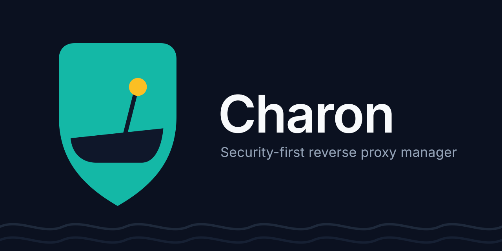

# Charon

**Your server, your rules — without the headaches.**

Charon is a self-hosted reverse proxy manager. Point your domain names at your
services, and Charon takes care of HTTPS certificates, security protections, and
access control, all from a simple web interface.

[Get started with Charon](getting-started.md){ .md-button .md-button--primary }
[Browse all features](features.md){ .md-button }

## Why Charon

- **Point and click.** Add a website with a form, not a configuration file.
- **Automatic HTTPS.** Certificates are requested and renewed for you.
- **Built-in protection.** Web application firewall, login protection, and
  CrowdSec threat detection work out of the box.
- **Backups you can restore.** Configuration backups and disaster recovery
  steps are documented for beginners.

Ready to begin? Follow the [Getting Started guide](getting-started.md).
